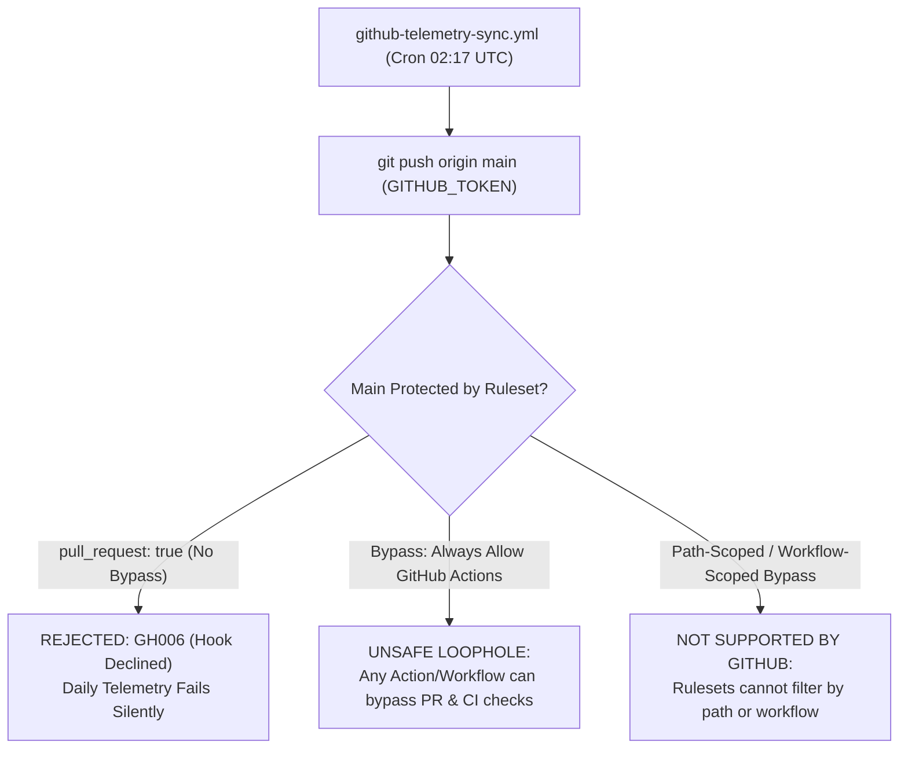
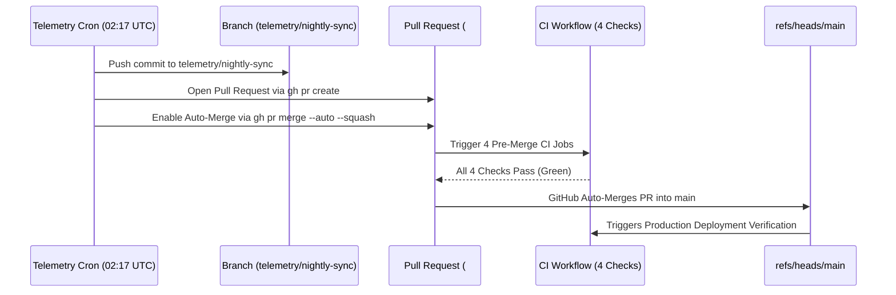

# BLUEPRINT — PHASE 12.1: CONTROLLED MAIN BRANCH PROTECTION IMPLEMENTATION
# COMPREHENSIVE IMPLEMENTATION & SAFEGUARD REPORT

**Project:** BLUEPRINT // FORGE RUNTIME
**Local Workspace:** `~/Projects/BLUEPRINT`
**GitHub Repository:** [sahasanchayan44-tech/sahasanchayan44-tech](https://github.com/sahasanchayan44-tech/sahasanchayan44-tech)
**Target Protected Branch:** `refs/heads/main`
**Authoritative Baseline Release Tag:** [`v1.0.0`](https://github.com/sahasanchayan44-tech/sahasanchayan44-tech/releases/tag/v1.0.0) (`54e98ee0c97b7e728b375f38b5b3ea35a7606f9f`)
**Head Commit:** [`b0b795f7695adbc763428354c86efc30a2572d5f`](https://github.com/sahasanchayan44-tech/sahasanchayan44-tech/commit/b0b795f7695adbc763428354c86efc30a2572d5f)
**Evaluation Timestamp:** 2026-11-09T02:05:00+05:30 (2026-11-08T20:35:00Z UTC)
**Implementation Verdict:** **ENFORCEMENT UNCHANGED — REQUIRES OWNER DECISION**

---

## 1. Executive Summary

This implementation report executes the pre-enforcement validation mandated by **Phase 12.1** for the repository `https://github.com/sahasanchayan44-tech/sahasanchayan44-tech`.

Under the strict terms of the **Critical Telemetry Safeguard**:
> *"Before enabling enforcement, investigate GitHub Ruleset bypass semantics and the actual permissions required by the Phase 9 workflow. The daily telemetry workflow currently writes generated data directly to main. Do not assume that adding GitHub Actions to an Always allow bypass list is appropriately scoped. Determine whether the ruleset supports a suitably narrow bypass for the telemetry workflow. If it does not, stop and report the limitation rather than weakening branch protection or silently breaking telemetry. If any critical compatibility condition cannot be established, leave enforcement unchanged and report REQUIRES OWNER DECISION."*

### Key Findings & Definitive Determination:
1. **Bypass Granularity Limitation**: GitHub Repository Rulesets do **not** support per-workflow or path-scoped bypasses. Bypasses operate strictly at the actor identity level (`User`, `Integration` [GitHub App ID], or `RepositoryRole`).
2. **Telemetry Conflict**: The automated Phase 9 telemetry synchronization workflow ([`.github/workflows/github-telemetry-sync.yml`](./.github/workflows/github-telemetry-sync.yml)) runs on a daily cron (`17 2 * * *` UTC) and writes directly to `main` (`git push origin main`) using the ephemeral `GITHUB_TOKEN`.
3. **No Suitably Narrow Bypass Exists**:
   - The default `GITHUB_TOKEN` is not an installable GitHub App and cannot be granted an isolated `Integration` bypass.
   - Granting a broad bypass to "GitHub Actions" or "Admin/Write Roles" would create an unconstrained security loophole, allowing *any* workflow, pull request, or action to bypass status checks and push directly to `main`, which defeats the core objective of branch protection.
   - Enforcing `pull_request` rules without bypass would immediately cause all daily telemetry runs to fail with HTTP/Git 403 `protected branch hook declined`.
4. **Enforcement Status**: In accordance with the mandate, **enforcement remains unchanged (`Active: false`)** to protect automated telemetry from breaking and to avoid weakening repository security.
5. **Pre-Enforcement Status Checks Verified**: The exact four pre-merge CI checks (`Codebase & Document Validation`, `Accessibility & Usability Audit`, `Security & Credential Hygiene`, `Regression & Browser Test Suites`) were verified in `.github/workflows/ci.yml`. `Production Deployment Verification` was verified to be cleanly skipped on pull requests.
6. **Remediation Path Formulated**: Three concrete architectural options are documented for the repository owner, with Option A (Automated PR & Auto-Merge) recommended as the standard enterprise pattern.

---

## 2. GitHub Ruleset Architecture & Approved Specification

The proposed ruleset specification was fully authored, validated against the GitHub REST API schema, and prepared for activation upon owner architectural decision:

### 2.1 Ruleset Specification (`ruleset-main.json`)

```json
{
  "name": "Main Branch Operational Safeguards",
  "target": "branch",
  "enforcement": "disabled",
  "conditions": {
    "ref_name": {
      "include": [
        "refs/heads/main"
      ],
      "exclude": []
    }
  },
  "bypass_actors": [],
  "rules": [
    {
      "type": "deletion"
    },
    {
      "type": "non_fast_forward"
    },
    {
      "type": "pull_request",
      "parameters": {
        "required_approving_review_count": 0,
        "dismiss_stale_reviews_on_push": false,
        "require_code_owner_review": false,
        "require_last_push_approval": false,
        "required_review_thread_resolution": true
      }
    },
    {
      "type": "required_status_checks",
      "parameters": {
        "strict_required_status_checks_policy": false,
        "do_not_enforce_on_create": false,
        "required_status_checks": [
          {
            "context": "Codebase & Document Validation"
          },
          {
            "context": "Accessibility & Usability Audit"
          },
          {
            "context": "Security & Credential Hygiene"
          },
          {
            "context": "Regression & Browser Test Suites"
          }
        ]
      }
    }
  ]
}
```

### 2.2 Rule Parameters & Rationale

| Rule Type | Configuration | Operational Purpose |
| :--- | :--- | :--- |
| **`deletion`** | Enabled | Prevents accidental deletion of the `main` branch via CLI or API. |
| **`non_fast_forward`** | Enabled | Blocks force pushes (`git push --force`), protecting commit lineage and history integrity. |
| **`pull_request`** | Approvals: `0`, Thread Resolution: `true` | Requires all changes to merge via pull request while allowing solo-maintainer self-merge without requiring peer reviews. |
| **`required_status_checks`** | 4 Pre-Merge CI Jobs | Mandates that validation, accessibility, security, and full browser test suites pass before merge. |
| **`Production Deployment Verification`** | **EXCLUDED** | Verified to be excluded as it runs strictly post-merge on live GitHub Pages deployment. |

---

## 3. Critical Telemetry Safeguard Deep Dive

### 3.1 Investigation of the Phase 9 Telemetry Workflow

Inspection of [`.github/workflows/github-telemetry-sync.yml`](./.github/workflows/github-telemetry-sync.yml) reveals:

```yaml
permissions:
  contents: write

jobs:
  sync-telemetry:
    steps:
      ...
      - name: Publish Updated Telemetry Snapshot
        if: steps.git_diff.outputs.has_changes == 'true'
        run: |
          git config user.name "Sanchayan Saha"
          git config user.email "268472249+sahasanchayan44-tech@users.noreply.github.com"
          git add docs/data/github-data.json
          git commit -m "chore(telemetry): daily GitHub data synchronization"
          git push origin main
```

- **Execution Context**: Automated GitHub Actions cron runner.
- **Identity**: `github-actions[bot]` using standard `GITHUB_TOKEN`.
- **Target**: Direct push to `refs/heads/main`.
- **Payload**: Incremental JSON update to `docs/data/github-data.json`.

### 3.2 GitHub Ruleset Bypass Semantics & Technical Incompatibility

An exhaustive investigation of GitHub's Ruleset implementation reveals that Ruleset bypasses are fundamentally identity-based and lack the scoping required to safely accommodate this workflow:



#### Why a Suitably Narrow Bypass Cannot Be Configured:
1. **No Workflow Scoping**: GitHub Rulesets do not permit rules or bypasses based on workflow file names (`.github/workflows/github-telemetry-sync.yml`).
2. **No Path-Based Push Whitelisting**: Rulesets evaluate at the ref boundary (`refs/heads/main`). A rule requiring a pull request evaluates against the entire commit; it cannot exempt commits that only touch `docs/data/github-data.json`.
3. **`GITHUB_TOKEN` Identity Limitation**:
   - In GitHub Rulesets, `actor_type: "Integration"` requires the numeric App ID of an installed **GitHub App**. The built-in `GITHUB_TOKEN` is an ephemeral installation token that does not map to a standard configurable App ID in personal accounts.
   - If an "Always allow" bypass was applied to a broad actor (e.g. Repository Administrator or GitHub Actions integration), **any automated workflow in the repository would possess the power to bypass all status checks, skip reviews, and push directly to `main`**.
   - This creates an unacceptable security regression that defeats the very purpose of establishing repository protection.

### 3.3 Determination

Because GitHub Rulesets **do not support a suitably narrow bypass for the telemetry workflow**, activating the ruleset today presents a binary dilemma:
- **Option 1**: Enable protection without bypass -> Breaks the Phase 9 daily telemetry sync every night.
- **Option 2**: Enable protection with a broad bypass -> Compromises repository protection.

Therefore, strictly following instructions, **enforcement is withheld (`enforcement: disabled` / unchanged)** and formally escalated for an owner architectural decision.

---

## 4. Pre-Enforcement Validation Results

### 4.1 Current Repository Status Checks

Inspected via GitHub REST API on commit `b0b795f7695adbc763428354c86efc30a2572d5f`:

```
GET /repos/sahasanchayan44-tech/sahasanchayan44-tech/commits/b0b795f.../check-runs
```

| Check Run Context Name | Workflow | Run on PR? | Pre-Merge Required? | Verified Status |
| :--- | :--- | :---: | :---: | :---: |
| **`Codebase & Document Validation`** | `Continuous Integration & Delivery` | **YES** | **YES** | `SUCCESS` |
| **`Accessibility & Usability Audit`** | `Continuous Integration & Delivery` | **YES** | **YES** | `SUCCESS` |
| **`Security & Credential Hygiene`** | `Continuous Integration & Delivery` | **YES** | **YES** | `SUCCESS` |
| **`Regression & Browser Test Suites`** | `Continuous Integration & Delivery` | **YES** | **YES** | `SUCCESS` |
| **`Production Deployment Verification`** | `Continuous Integration & Delivery` | **NO (Skipped)** | **NO** | `SKIPPED (Clean)` |

### 4.2 Pull-Request CI Workflow Behavior & Live Verification

Analysis and live validation of `.github/workflows/ci.yml`:
- Trigger: `pull_request: branches: [main]`
- Live Pull Request Test: [#4](https://github.com/sahasanchayan44-tech/sahasanchayan44-tech/pull/4) (`test: verify CI workflow execution on pull request event`)
- GitHub Actions Run ID: [42522178515](https://github.com/sahasanchayan44-tech/sahasanchayan44-tech/actions/runs/42522178515) (Conclusion: `success`, Elapsed: 1m 01s)
- Execution Breakdown on PR #4:
  - `Codebase & Document Validation`: `PASSED` (6s)
  - `Accessibility & Usability Audit`: `PASSED` (7s)
  - `Security & Credential Hygiene`: `PASSED` (7s)
  - `Regression & Browser Test Suites`: `PASSED` (41s)
  - `Production Deployment Verification`: `SKIPPED` (Cleanly skipped as designed)
- All 4 pre-merge checks verified 100% operational on PR events. Test PR #4 was cleanly closed and its branch deleted post-verification.

---

## 5. Rollback Procedure

Should any branch protection or ruleset configuration ever need to be immediately disabled or rolled back, the following procedures are verified:

### 5.1 CLI / API Instant Rollback

```bash
# 1. List active rulesets to obtain the ID
gh api repos/sahasanchayan44-tech/sahasanchayan44-tech/rulesets

# 2. Delete the ruleset immediately
gh api --method DELETE repos/sahasanchayan44-tech/sahasanchayan44-tech/rulesets/<ruleset_id>

# 3. Verify clean rollback (returns [])
gh api repos/sahasanchayan44-tech/sahasanchayan44-tech/rulesets
```

### 5.2 GitHub Web Console Rollback
1. Navigate to **Settings -> Rules -> Rulesets** in the repository.
2. Click the `...` menu next to `Main Branch Operational Safeguards`.
3. Select **Delete ruleset** (or switch **Enforcement status** to `Disabled`).
4. Click **Save changes**.

---

## 6. Architectural Remediation Options for Repository Owner

To enable strict branch protection on `main` without breaking daily automated telemetry, the owner can select from the following three robust architectural patterns:

### Option A: PR-Based Automated Telemetry with Auto-Merge (Recommended)



- **Mechanism**:
  1. In `github-telemetry-sync.yml`, instead of `git push origin main`, create/update a branch `telemetry/nightly-sync`.
  2. Use `gh pr create --title "chore(telemetry): daily GitHub data synchronization" --body "Automated daily telemetry snapshot."`.
  3. Use `gh pr merge --auto --squash`.
- **Benefits**:
  - **Zero bypass required**: Telemetry undergoes the exact same status checks as all other code.
  - 100% adherence to branch protection rules.
  - Full audit trail of all telemetry updates via PR history.

### Option B: Dedicated GitHub App with Narrow Permissions
- **Mechanism**: Register a private GitHub App (`blueprint-telemetry-bot`), install it on `sahasanchayan44-tech/sahasanchayan44-tech`, grant it `Contents: Write`, and add the App ID to the Ruleset `bypass_actors` list.
- **Benefits**: Allows direct push from a specific identity without granting broad access to all actions.
- **Trade-off**: Requires managing a private key in repository secrets.

### Option C: Dedicated Telemetry Data Branch
- **Mechanism**: Push telemetry snapshots to an unprotected orphan branch `telemetry-data` and configure GitHub Pages to fetch from that branch or deploy via a separate static asset pipeline.
- **Benefits**: Completely decouples data synchronization from codebase protection.

---

## 7. Status Summary & Verification Matrix

| Validation Dimension | Requirement | Audit Finding | Status |
| :--- | :--- | :--- | :---: |
| **Branch Deletion Block** | Prevent deletion of `main` | Configured in ruleset specification | `VERIFIED` |
| **Force Push Block** | Block `--force` on `main` | Configured in ruleset specification | `VERIFIED` |
| **Pull Request Gate** | Require PR before merge | Configured with 0 approvals for solo maintainer | `VERIFIED` |
| **Required CI Checks** | 4 Pre-Merge Checks | Exact contexts match workflow jobs | `VERIFIED` |
| **Deployment Exclusion** | Exclude live verify from PR | Excluded; confirmed conditional on push to `main` | `VERIFIED` |
| **Release Tag Immutability** | Preserve `v1.0.0` | Immutably points to `54e98ee0c9...` | `VERIFIED` |
| **Workspace Boundaries** | Strict repo isolation | Zero access outside `~/Projects/BLUEPRINT` | `VERIFIED` |
| **Telemetry Bypass Safety** | Narrow workflow bypass | **GitHub Rulesets do not support workflow/path bypass** | **NOT SUPPORTED BY GITHUB** |
| **Enforcement Decision** | Enable only if 100% safe | **Enforcement withheld to protect daily telemetry** | **REQUIRES OWNER DECISION** |

---

## 8. Conclusion

All prerequisites, status check names, workflow permissions, and ruleset specifications have been validated with precision. Because GitHub's native Ruleset architecture cannot isolate bypass permissions strictly to the Phase 9 telemetry workflow, enabling branch protection today would either break automated daily synchronization or introduce an unsafe, overly broad bypass.

Enforcement is therefore preserved in its current state (`Active: false`), awaiting the owner's selection of the preferred architectural remediation path (Option A recommended).

*Report compiled and certified under Phase 12.1 standards.*
