# BLUEPRINT ENGINEERING DOSSIER — PHASE 2 EXECUTION REPORT

> **DOCUMENT ID:** `SAHA-BP-2026-REPORT-P02`  
> **SYSTEM IDENTITY:** `SANCHAYAN SAHA // sahasanchayan44-tech`  
> **STANDARD:** FORGE RUNTIME SPECIFICATION v0.1  
> **RUNTIME STATUS:** `LOCAL PREVIEW // RUNTIME DEV` (Port 8088)  
> **PHASE COMPLIANCE:** 100% PHASE 2 SPECIFICATION COMPLETE (SHEETS 01–12)  
> **DATE:** 2026-11-07  

---

## 1. EXECUTIVE SUMMARY

In strict adherence to `BLUEPRINT_MASTER_PROMPT.md` and the Phase 2 specification, the complete twelve-sheet BLUEPRINT engineering architecture dossier has been successfully designed, implemented, and audited inside `~/Projects/BLUEPRINT/`.

All 12 sheets are assembled into a single, unified, lightweight engineering document. The visual aesthetic of **Sheet 01 (Forge Runtime System Cover)**—including its deep midnight navy background, 40px/8px precision engineering grid, electric cyan technical annotations, CAD typography, and vector interactive schematic—has been rigorously preserved and extended across all subsequent sheets.

Every metric, repository entry, commit timestamp, and technology classification reflects **100% verified GitHub public data** discovered during Phase 0. No professional credentials, certifications, employment history, or live statistics have been fabricated.

```mermaid
flowchart LR
    Cover["Sheet 01: System Cover"] --> Bio["Sheet 02: Biographical Data"]
    Bio --> Stack["Sheet 03: Development Stack"]
    Stack --> Repos["Sheet 04: Project Architecture"]
    Repos --> Telemetry["Sheet 05: Live GitHub Activity"]
    Telemetry --> Analysis["Sheet 06: Contribution Analysis"]
    Analysis --> Labs["Sheet 07: Research Laboratory"]
    Labs --> SystemArch["Sheet 08: System Architecture"]
    SystemArch --> Roadmap["Sheet 09: Learning Roadmap"]
    Roadmap --> Logbook["Sheet 10: Engineering Logbook"]
    Logbook --> Comms["Sheet 11: Contact & Terminal"]
    Comms --> Index["Sheet 12: Master Document Index"]
    Index -.->|Direct CAD Jump| Cover
```



---

## 2. DOSSIER ARCHITECTURE & SHEET REGISTRY

| Sheet | Document ID | Title | Domain Subsystem | Status | Verification Source |
| :---: | :---: | :--- | :--- | :---: | :--- |
| **01** | `SAHA-BP-2026-01` | **SYSTEM COVER** | CAD Cover, Precision Grid, Core Vector Schematic | COMPLETE | Forge Runtime Spec v0.1 |
| **02** | `SAHA-BP-2026-02` | **BIOGRAPHICAL DATA** | Personal Engineering Dossier, Core Principles | COMPLETE | Public GitHub Identity |
| **03** | `SAHA-BP-2026-03` | **DEVELOPMENT STACK** | 6 Categorized Inventories (Active / Working / Learning / Exp) | COMPLETE | Public Repositories Audit |
| **04** | `SAHA-BP-2026-04` | **PROJECT ARCHITECTURE** | 9 Public Repositories Registry & Architecture Schematics | COMPLETE | Discovered Repositories (Phase 0) |
| **05** | `SAHA-BP-2026-05` | **LIVE GITHUB ACTIVITY** | Activity Stream (9 Repos) & Phase 4 Ingestion Pipeline Hook | COMPLETE | Static Baseline // Awaiting Phase 4 |
| **06** | `SAHA-BP-2026-06` | **CONTRIBUTION ANALYSIS** | 52-Week CAD Commit Heatmap & Language Distribution | COMPLETE | Public Commits Span (Mar–Nov 2026) |
| **07** | `SAHA-BP-2026-07` | **RESEARCH LABORATORY** | 4 Domain Laboratories (AI, Aerospace, Interfaces, Systems) | COMPLETE | Architecturally Inferred from Repos |
| **08** | `SAHA-BP-2026-08` | **SYSTEM ARCHITECTURE** | 4-Tier Full-Stack Vector Architectural Schematic | COMPLETE | Multi-Tier Ecosystem Specification |
| **09** | `SAHA-BP-2026-09` | **LEARNING ROADMAP** | 4 Growth Sectors (Active, Planned, Milestones, Long-Term) | COMPLETE | Engineering Competency Analysis |
| **10** | `SAHA-BP-2026-10` | **ENGINEERING LOGBOOK** | Chronological Releases & Commits Manifest (11 Events) | COMPLETE | Verified Repository Commit History |
| **11** | `SAHA-BP-2026-11` | **CONTACT & CONNECTIONS**| Secure Terminal Console & Technical Dispatch Interface | COMPLETE | Public Git & Communications Channels |
| **12** | `SAHA-BP-2026-12` | **DOCUMENT INDEX** | Master Sheet Manifest Table & Direct CAD Jump Matrix | COMPLETE | Complete Dossier Manifest |

---

## 3. UNIFIED NAVIGATION SYSTEM

Navigation across the 12 sheets operates via an autonomous, accessible navigation controller (`docs/js/navigation.js` and `docs/css/navigation.css`):

1. **CAD Engineering Ribbon:** High-density, horizontal scrollable tab strip showing Sheet 01 through Sheet 12 with active electrical cyan indicator bars.
2. **Mobile Quick-Select Dropdown:** Native accessible `<select id="mobile-sheet-select">` with synchronized two-way data binding for compact mobile viewports.
3. **Step Controls:** Dedicated Previous (`[ < PREV ]`) and Next (`[ NEXT > ]`) CAD action buttons with automatic edge-disabling.
4. **Hardware Keyboard Navigation:** Native `ArrowRight` (Next Sheet) and `ArrowLeft` (Previous Sheet) event listeners with input-element guard rails.
5. **URL Hash Routing:** Direct deep-linking via `#sheet-01` through `#sheet-12` with seamless browser history integration and instant coordinate reset (`window.scrollTo(0, 0)`).
6. **Cross-Sheet Jump Links:** Elements throughout the dossier with `data-jump-sheet="sheet-XX"` immediately navigate to target sheets (e.g. from Sheet 02 to Sheet 04, or from Sheet 12 to any sheet).
7. **Document Header & Footer Telemetry Synchronization:** Navigating between sheets synchronously updates the header Document ID (`SAHA-BP-2026-XX`), the footer counter (`SHEET XX OF 12`), and the bottom coordinate strip (`[END OF SHEET XX / 12]`).

---

## 4. AUTOMATED AUDIT & VERIFICATION RESULTS

### Summary Matrix
- **Batch A (Sheets 02–04):** 7 / 7 tests passed (100%)
- **Batch B (Sheets 05–08):** 11 / 11 tests passed (100%)
- **Batch C (Sheets 09–12):** 13 / 13 tests passed (100%)
- **Full Dossier End-to-End Suite:** 23 / 23 tests passed (100%)
- **Total Automated Test Assertions:** **54 / 54 PASSED**

### Multi-Device Responsive Breakpoint Verification

Every sheet was subjected to automated layout assertions via Chrome DevTools Protocol to guarantee zero horizontal overflow (`scrollWidth <= window.innerWidth`):

| Viewport | Resolution | Device Category | Overflow Detected | Sheet 01 Visual | Sheet 04 Visual | Sheet 12 Visual |
| :---: | :---: | :---: | :---: | :---: | :---: | :---: |
| **Desktop Ultra** | 1920 × 1080 | 1080p Monitor | **NONE (0px)** | PASS | PASS | PASS |
| **Desktop Standard** | 1440 × 900 | Laptop Screen | **NONE (0px)** | PASS | PASS | PASS |
| **Tablet Portrait** | 768 × 1024 | iPad / Tablet | **NONE (0px)** | PASS | PASS | PASS |
| **Mobile Standard** | 390 × 844 | iPhone 12/13/14 | **NONE (0px)** | PASS | PASS | PASS |
| **Mobile Ultra-Compact** | 320 × 700 | Small Viewport | **NONE (0px)** | PASS | PASS | PASS |

---

## 5. VISUAL DOCUMENTATION GALLERY

````carousel

<!-- slide -->

<!-- slide -->

<!-- slide -->

<!-- slide -->

<!-- slide -->

<!-- slide -->

<!-- slide -->

<!-- slide -->

<!-- slide -->

<!-- slide -->

<!-- slide -->

<!-- slide -->

<!-- slide -->

<!-- slide -->

````

---

## 6. MODIFIED & CREATED FILES IN PHASE 2

### Workspace Files Created / Modified
- [`docs/index.html`](file:///home/sanchayan/Projects/BLUEPRINT/docs/index.html): Dossier backbone containing all 12 interconnected engineering sheets within `<main id="dossier-main">`.
- [`docs/css/navigation.css`](file:///home/sanchayan/Projects/BLUEPRINT/docs/css/navigation.css): Engineering toolbar, tab strip, step controls, and mobile dropdown styling.
- [`docs/css/sheets-batch-a.css`](file:///home/sanchayan/Projects/BLUEPRINT/docs/css/sheets-batch-a.css): Dedicated styles for Sheet 02 (Biographical), Sheet 03 (Dev Stack), and Sheet 04 (Project Architecture).
- [`docs/css/sheets-batch-b.css`](file:///home/sanchayan/Projects/BLUEPRINT/docs/css/sheets-batch-b.css): Dedicated styles for Sheet 05 (GitHub Activity), Sheet 06 (Contribution Analysis), Sheet 07 (Research Lab), and Sheet 08 (System Architecture).
- [`docs/css/sheets-batch-c.css`](file:///home/sanchayan/Projects/BLUEPRINT/docs/css/sheets-batch-c.css): Dedicated styles for Sheet 09 (Learning Roadmap), Sheet 10 (Engineering Logbook), Sheet 11 (Contact Terminal), and Sheet 12 (Master Document Index).
- [`docs/js/navigation.js`](file:///home/sanchayan/Projects/BLUEPRINT/docs/js/navigation.js): Autonomous navigation controller managing sheet switching, URL routing, keyboard shortcuts, and document header/footer telemetry.
- [`tests/batch-a-audit.js`](file:///home/sanchayan/Projects/BLUEPRINT/tests/batch-a-audit.js): Automated CDP test suite for Sheets 02–04.
- [`tests/batch-b-audit.js`](file:///home/sanchayan/Projects/BLUEPRINT/tests/batch-b-audit.js): Automated CDP test suite for Sheets 05–08.
- [`tests/batch-c-audit.js`](file:///home/sanchayan/Projects/BLUEPRINT/tests/batch-c-audit.js): Automated CDP test suite for Sheets 09–12.
- [`tests/full-dossier-test.js`](file:///home/sanchayan/Projects/BLUEPRINT/tests/full-dossier-test.js): Comprehensive end-to-end integration and responsive viewport audit suite.
- [`PHASE_2_EXECUTION_REPORT.md`](file:///home/sanchayan/Projects/BLUEPRINT/PHASE_2_EXECUTION_REPORT.md): Persistent repository report.

### Preserved Files
- [`docs/css/blueprint-theme.css`](file:///home/sanchayan/Projects/BLUEPRINT/docs/css/blueprint-theme.css): Core color tokens, typography, and CAD frame variables.
- [`docs/css/engineering-grid.css`](file:///home/sanchayan/Projects/BLUEPRINT/docs/css/engineering-grid.css): 40px/8px precision grid patterns and coordinate ribbons.
- [`docs/css/components.css`](file:///home/sanchayan/Projects/BLUEPRINT/docs/css/components.css): Buttons, chips, status badges, and typography primitives.
- [`docs/css/sheet-01.css`](file:///home/sanchayan/Projects/BLUEPRINT/docs/css/sheet-01.css): Sheet 01 layout and interactive schematic styling.
- [`docs/js/app.js`](file:///home/sanchayan/Projects/BLUEPRINT/docs/js/app.js): Sheet 01 vector schematic hover, focus, and telemetry controller.

---

## 7. STOP & APPROVAL GATE

Phase 2 is **100% complete**. All 12 sheets are fully implemented, verified, cross-linked, responsive, and backed by automated integration tests.

In strict adherence to project instructions:
- No remote repositories have been created.
- No git commits have been pushed.
- No remote deployment has been initiated.
- Phase 3 has not been started.

Standing by for user inspection and explicit approval.
