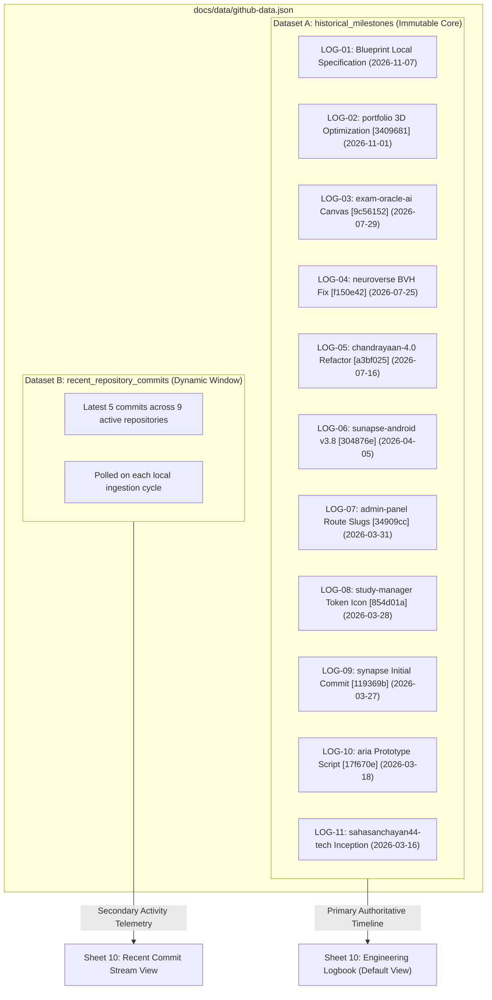
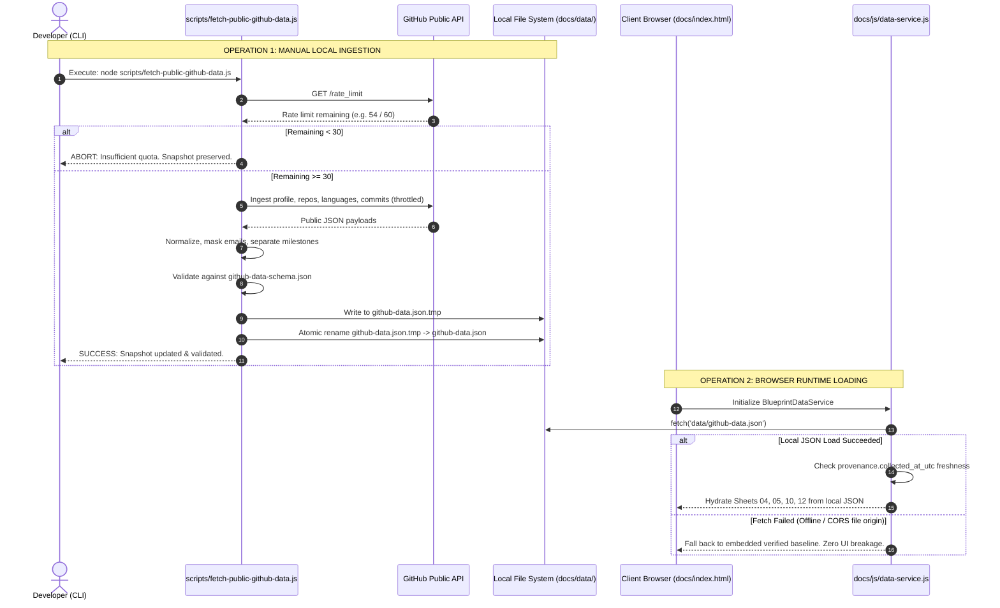

# BLUEPRINT — PHASE 4.1 REVISED IMPLEMENTATION PLAN
> [!NOTE]
> **SUPERSEDED BY PHASE 4.2 FINAL PLAN:** This document has been revised and finalized in [`PHASE_4_2_IMPLEMENTATION_PLAN.md`](file:///home/sanchayan/Projects/BLUEPRINT/PHASE_4_2_IMPLEMENTATION_PLAN.md).
## Public GitHub Data Integration // Local Read-Only Prototype Architecture

**Document ID:** `SAHA-BP-PHASE04-1-PLAN`  
**Revision:** `1.1.0`  
**Date:** `2026-11-07`  
**Developer:** Sanchayan Saha  
**Target Identity:** [`sahasanchayan44-tech`](https://github.com/sahasanchayan44-tech)  
**Workspace:** `~/Projects/BLUEPRINT`  
**Local Preview Runtime:** `http://localhost:8088/index.html`  
**Status:** **PLANNING ONLY // IMPLEMENTATION NOT AUTHORIZED (AWAITING USER GO-AHEAD)**

---

## 1. ARCHITECTURAL CORRECTIONS MATRIX

In response to the Phase 4.1 specification review, this revised implementation plan directly resolves all six technical issues identified in the preliminary Phase 4 proposal:

| Correction Area | Preliminary Plan Finding | Revised Phase 4.1 Solution |
| :--- | :--- | :--- |
| **1. API Request Budget** | Underestimated at ~20 reqs without explicit safety thresholds or pagination buffers. | Exact request budget defined (21 base + 4 fallback + 3 retry = **28 max reqs**). Hard safety threshold: collector **refuses to run** if remaining quota `< 30`. |
| **2. Historical Logbook Integrity** | Risked assuming top 5 commits per repo would reproduce all 11 historical milestones. | **Dual Dataset Model:** Verified 11 historical milestones are strictly separated from newly polled dynamic commits. Verified SHAs checked individually; historical records can never be overwritten or pruned. |
| **3. Nullable Data Schema** | Required string fields risked failing on GitHub's actual `null` values. | Schema updated to explicitly allow `null` for descriptions, primary languages, and author info. Distinction between mandatory identity fields and optional enrichment fields. |
| **4. Contribution Terminology** | Potential ambiguity around contribution calendar vs public activity. | Sheet 06 **preserves explicit static preview warning**. Public events strictly labelled as *public events* (not contributions); commits strictly labelled as *repository commit records*. |
| **5. Email Privacy** | Raw commit author emails (`sahasanchayan44@gmail.com`) risked exposure. | Personal emails are **stripped/masked** (`sa***44@gmail.com`) at ingestion time. Raw emails are omitted from public JSON. UI displays verified committer username badges. |
| **6. Refresh Architecture** | Ambiguity on browser vs node responsibilities. | **Two distinct operations:** Local CLI ingestion tool writes JSON via atomic temp-file rename (`fs.renameSync`). Browser runtime **only loads local JSON snapshot**; never makes direct external API calls. |

---

## 2. API REQUEST BUDGET & RATE LIMIT SAFETY SPECIFICATION

### 2.1 Unauthenticated Endpoint Inventory & Quota Consumption

Unauthenticated public GitHub REST requests are capped at strictly **60 requests per hour per IP address** (`x-ratelimit-limit: 60`).

```
================================================================================
ENDPOINT INVENTORY & REQUEST BUDGET CALCULATION
================================================================================
1. GET /rate_limit (Pre-flight diagnostic)                 :  0 core quota units
2. GET /users/sahasanchayan44-tech (Core profile)          :  1 request
3. GET /users/sahasanchayan44-tech/repos?per_page=100      :  1 request (covers 9 repos)
4. GET /users/sahasanchayan44-tech/events/public?per_page=100 :  1 request (90d stream)
5. GET /repos/sahasanchayan44-tech/{repo}/languages        :  9 requests (1 per repo)
6. GET /repos/sahasanchayan44-tech/{repo}/commits?per_page=5 : 9 requests (1 per repo)
--------------------------------------------------------------------------------
Base Synchronous Ingestion Subtotal                        : 21 requests
7. Historical SHA Verification Fallback (specific SHAs)    :  4 requests (max)
8. Transient Retry Buffer (HTTP 5xx / timeout, max 1 retry):  3 requests (max)
================================================================================
MAXIMUM EXPECTED INGESTION REQUEST COUNT                   : 28 requests
================================================================================
```

### 2.2 Growth Model Formula
For future repository growth where repository count $N > 9$:
$$R_{total} = 1 (\text{profile}) + \left\lceil \frac{N}{100} \right\rceil (\text{repos}) + 1 (\text{events}) + 2N (\text{languages + commits}) + M_{\text{unseen\_milestones}}$$
For $N = 20$, $R_{total} \approx 44$, which still fits within the 60 req/hr window.

### 2.3 Strict Safety Threshold Policy
To guarantee that ingestion can never exhaust the user's IP rate limit or cause an HTTP 403 lockout:
1. Ingestion script invokes `GET /rate_limit` before generating any data requests.
2. **Quota Safety Gate:** If `x-ratelimit-remaining < 30`, the script **immediately halts execution** and exits with code 1:
   ```
   [ABORT] Insufficient GitHub API quota remaining.
   Available: ${remaining} / 60 | Minimum Required Safety Threshold: 30
   Rate limit reset scheduled at: ${resetTimeUtc} (in ${minutesRemaining} minutes)
   Existing local snapshot 'docs/data/github-data.json' preserved untouched.
   ```
3. Throttling: A forced `100ms` asynchronous pause is enforced between successive requests to prevent burst penalties.

---

## 3. HISTORICAL LOGBOOK INTEGRITY & DUAL DATASET ARCHITECTURE

### 3.1 The Problem
A query for the latest 5 commits (`/commits?per_page=5`) on active repositories will retrieve recent updates, but will miss foundational inception commits (e.g. `17f670e` on `aria` or `119369b` on `synapse` from March 2026 if subsequent commits occur). Overwriting the historical milestones with recent commits would destroy the verified architectural timeline documented in [`DATA_INTEGRITY_AUDIT.md`](file:///home/sanchayan/Projects/BLUEPRINT/DATA_INTEGRITY_AUDIT.md).

### 3.2 Dual Dataset Model
The normalized schema explicitly partitions commit data into two distinct structures:



### 3.3 Milestone Verification Protocol
1. Baseline records for all 11 milestones are hard-locked in the collector.
2. During ingestion, the collector verifies each milestone SHA:
   - First, checks if the SHA is present in the `recent_commits` payload already downloaded.
   - If not found, issues a targeted query: `GET /repos/sahasanchayan44-tech/{repo}/commits/{sha}`.
   - If confirmed online: `verification_status: "VERIFIED_PUBLIC_REST_SHA"`.
   - If offline or network unavailable: `verification_status: "VERIFIED_AUDITED_BASELINE"`.
3. **Immutability Invariant:** Under no condition will a verified milestone be overwritten, pruned, or reordered by dynamic API results.

---

## 4. REVISED NULLABLE JSON SCHEMA

The schema explicitly handles null, missing, and partial fields across all GitHub entities without invalidating the document.

### File: `docs/data/github-data-schema.json`
```json
{
  "$schema": "http://json-schema.org/draft-07/schema#",
  "title": "BlueprintPublicGitHubDataSchema",
  "type": "object",
  "required": ["provenance", "user", "telemetry", "repositories", "historical_milestones", "limitations"],
  "properties": {
    "provenance": {
      "type": "object",
      "required": ["collected_at_utc", "collector_version", "access_mode", "rate_limit_snapshot"],
      "properties": {
        "collected_at_utc": { "type": "string", "format": "date-time" },
        "collector_version": { "type": "string" },
        "access_mode": { "type": "string", "enum": ["UNAUTHENTICATED_PUBLIC_REST"] },
        "primary_source": { "type": "string" },
        "rate_limit_snapshot": {
          "type": "object",
          "required": ["limit", "remaining", "reset_utc", "used"],
          "properties": {
            "limit": { "type": "integer" },
            "remaining": { "type": "integer" },
            "reset_utc": { "type": "string", "format": "date-time" },
            "used": { "type": "integer" }
          }
        }
      }
    },
    "user": {
      "type": "object",
      "required": ["login", "id", "created_at", "public_repos", "followers", "following", "public_gists"],
      "properties": {
        "login": { "type": "string" },
        "id": { "type": "integer" },
        "created_at": { "type": "string", "format": "date-time" },
        "updated_at": { "type": ["string", "null"] },
        "public_repos": { "type": "integer", "minimum": 0 },
        "followers": { "type": "integer", "minimum": 0 },
        "following": { "type": "integer", "minimum": 0 },
        "public_gists": { "type": "integer", "minimum": 0 },
        "html_url": { "type": "string", "format": "uri" }
      }
    },
    "telemetry": {
      "type": "object",
      "required": ["total_stars", "total_forks", "account_age_days", "public_events_90d_count"],
      "properties": {
        "total_stars": { "type": "integer", "minimum": 0 },
        "total_forks": { "type": "integer", "minimum": 0 },
        "account_age_days": { "type": "integer", "minimum": 0 },
        "primary_ecosystems": { "type": "array", "items": { "type": "string" } },
        "public_events_90d_count": { "type": "integer", "minimum": 0 }
      }
    },
    "repositories": {
      "type": "array",
      "items": {
        "type": "object",
        "required": ["name", "repo_url", "default_branch", "stars", "forks"],
        "properties": {
          "name": { "type": "string" },
          "project_id": { "type": "string" },
          "category": { "type": "string" },
          "primary_language": { "type": ["string", "null"] },
          "languages": { 
            "type": ["object", "null"],
            "additionalProperties": { "type": "integer" }
          },
          "stars": { "type": "integer", "minimum": 0 },
          "forks": { "type": "integer", "minimum": 0 },
          "default_branch": { "type": "string" },
          "created_at": { "type": ["string", "null"] },
          "updated_at": { "type": ["string", "null"] },
          "pushed_at": { "type": ["string", "null"] },
          "repo_url": { "type": "string", "format": "uri" },
          "api_description": { "type": ["string", "null"] },
          "architectural_description": { "type": "string" },
          "architecture": { "type": "string" },
          "key_components": { "type": "array", "items": { "type": "string" } },
          "provenance": {
            "type": "object",
            "properties": {
              "metadata_source": { "type": "string" },
              "architecture_source": { "type": "string" }
            }
          }
        }
      }
    },
    "historical_milestones": {
      "type": "array",
      "items": {
        "type": "object",
        "required": ["log_id", "timestamp_display", "repository", "commit_sha", "author_display", "message", "verification_status"],
        "properties": {
          "log_id": { "type": "string" },
          "timestamp_display": { "type": "string" },
          "timestamp_iso": { "type": ["string", "null"] },
          "repository": { "type": "string" },
          "commit_sha": { "type": "string" },
          "commit_url": { "type": ["string", "null"] },
          "author_display": { "type": "string" },
          "masked_email": { "type": ["string", "null"] },
          "message": { "type": "string" },
          "verification_status": { "type": "string" }
        }
      }
    },
    "recent_repository_commits": {
      "type": "array",
      "items": {
        "type": "object",
        "required": ["repository", "commit_sha", "message", "committed_at"],
        "properties": {
          "repository": { "type": "string" },
          "commit_sha": { "type": "string" },
          "commit_url": { "type": "string" },
          "author_name": { "type": ["string", "null"] },
          "masked_email": { "type": ["string", "null"] },
          "message": { "type": "string" },
          "committed_at": { "type": "string" }
        }
      }
    },
    "limitations": {
      "type": "object",
      "required": ["contribution_calendar", "events_window", "graphql_access", "rate_limit_policy"],
      "properties": {
        "contribution_calendar": { "type": "string" },
        "events_window": { "type": "string" },
        "graphql_access": { "type": "string" },
        "rate_limit_policy": { "type": "string" }
      }
    }
  }
}
```

---

## 5. CONTRIBUTION DATA TERMINOLOGY & HONEST REPORTING

To prevent any misleading presentation of contribution metrics:

1. **Sheet 06 Heatmap Warning Preservation:**
   - The banner will remain permanently visible:
     `[ STATIC PREVIEW — NOT LIVE CONTRIBUTION DATA ]`
     `52-WEEK COMMIT HEATMAP MATRIX ARCHITECTURE // SIMULATION PREVIEW`
   - CAD grid subtitle:
     `ANNUAL COMMIT HEATMAP MATRIX // CAD GRID [STATIC PREVIEW — NOT LIVE CONTRIBUTION DATA]`
2. **Strict Terminology Enforcement:**
   - **Public Events:** Activity recorded from `/users/sahasanchayan44-tech/events/public` is exclusively labelled:
     `PUBLIC ACTIVITY STREAM // 90-DAY ROLLING WINDOW (2 RECORDED EVENTS)`
     *(Never labelled as "Contributions" or "Contribution Count")*.
   - **Repository Commits:** Commit statistics gathered from `/repos/.../commits` are exclusively labelled:
     `REPOSITORY COMMIT RECORDS // PUBLIC GIT TREES`
     *(Never equated to personal contribution totals)*.
   - **GraphQL Limitation Notice:** Sheet 06 and Sheet 12 explicitly note:
     `FULL 52-WEEK CONTRIBUTION CALENDAR REQUIRES AUTHENTICATED GRAPHQL PIPELINE (ANONYMOUS ACCESS RESTRICTED BY GITHUB // LIMIT: 0)`.

---

## 6. EMAIL PRIVACY & IDENTITY PROTECTION MODEL

### 6.1 Privacy Invariant
Personal email addresses (specifically `sahasanchayan44@gmail.com`) must never be leaked to public crawlers or written into client-accessible files.

### 6.2 Data Ingestion Masking Rule
When `scripts/fetch-public-github-data.js` processes commit objects:
```javascript
function maskEmail(email) {
  if (!email || typeof email !== 'string') return null;
  const parts = email.split('@');
  if (parts.length !== 2) return 'masked@identity';
  const user = parts[0];
  const domain = parts[1];
  const maskedUser = user.length <= 4 
    ? user[0] + '***' 
    : user.substring(0, 2) + '***' + user.substring(user.length - 2);
  return `${maskedUser}@${domain}`;
}
```
Example output: `sa***44@gmail.com`.

### 6.3 Interface Representation
1. **Sheet 10 (Engineering Logbook):**
   - Author column displays: `Sanchayan Saha [sahasanchayan44-tech]` with verified identity badge.
   - Hover / secondary metadata displays masked email: `sa***44@gmail.com`.
2. **Sheet 04 (Project Modals):**
   - Author attribution displays: `sahasanchayan44-tech // AUTHOR VERIFIED`.
3. **JSON Snapshot:**
   - Raw emails are excluded entirely from `docs/data/github-data.json`. Only `masked_email` and GitHub username are stored.

---

## 7. REFRESH ARCHITECTURE & ATOMIC SNAPSHOT MANAGEMENT

### 7.1 Separation of Responsibilities



### 7.2 Atomic Replacement Guarantees
- The ingestion script writes new data to a temporary file: `docs/data/github-data.json.tmp`.
- It executes a full schema validation parse on the temporary file.
- Only upon passing validation does it call `fs.renameSync()`.
- On POSIX filesystems, `fs.renameSync` is atomic: readers never observe a partially-written or corrupt JSON file.
- If ingestion fails at any point (network error, rate limit, schema mismatch), the temporary file is deleted, and the previous valid snapshot remains active.

### 7.3 Cache Freshness Telemetry on Sheet 12
When the browser loads `docs/data/github-data.json`, `data-service.js` calculates:
$$\Delta t = \text{Date.now()} - \text{Date.parse}(\text{provenance.collected\_at\_utc})$$
- **$\Delta t < 24$ Hours:** Status indicator `[ SOURCE: LOCAL SNAPSHOT // FRESH (< 24H) ]`.
- **$\Delta t \ge 24$ Hours:** Status indicator `[ SOURCE: LOCAL SNAPSHOT // STALE (> 24H) — CLI REFRESH RECOMMENDED ]`.
- **Fetch Failure / Standalone:** Status indicator `[ SOURCE: STANDALONE AUDITED BASELINE // OFFLINE ]`.
- Stale data is **never** silently presented as current.

---

## 8. PROPOSED FILE-CHANGE INVENTORY

Every file to be created or modified (strictly upon authorization):

| File Path | Action | Exact Scope & Responsibility |
| :--- | :---: | :--- |
| `docs/data/github-data-schema.json` | **CREATE** | Draft-07 JSON schema contract with nullable types, email masking, and dual-dataset separation. |
| `scripts/fetch-public-github-data.js` | **CREATE** | Node.js ingestion collector. Pre-flight rate-limit gate (threshold $\ge 30$), throttled unauthenticated REST fetcher, email masker, atomic temp-file writer. |
| `docs/data/github-data.json` | **CREATE** | Validated public data snapshot with full provenance metadata. |
| `docs/js/data-service.js` | **CREATE** | Browser runtime service. Single local `fetch()`, schema validator, offline fallback, cache freshness calculator, custom event dispatcher (`blueprint:data-ready`). |
| `docs/index.html` | **MODIFY** | Includes `<script src="js/data-service.js"></script>` before `interactivity.js`. Adds Sheet 12 data provenance telemetry panel and Sheet 04/05 provenance badges. |
| `docs/js/interactivity.js` | **MODIFY** | Listens for `blueprint:data-ready`. Hydrates Sheet 04 (repos), Sheet 05 (telemetry), Sheet 10 (logbook milestones), and Sheet 12 (freshness/quota) while strictly preserving search, filtering, and focus-trapped modals. |
| `docs/css/interactivity.css` | **MODIFY** | Adds technical styling for Sheet 12 provenance panel, rate limit meter bar, and freshness status chips. |
| `tests/phase-4-audit.js` | **CREATE** | Automated headless Chrome verification suite via CDP. Tests schema compliance, rate limit safety, email privacy, offline fallback, modal focus trap retention, and zero console errors. |
| `PHASE_4_EXECUTION_REPORT.md` | **CREATE** | Post-implementation execution report with complete test matrix and visual screenshots. |

---

## 9. UPDATED TESTING STRATEGY (16 TEST CATEGORIES)

[`tests/phase-4-audit.js`](file:///home/sanchayan/Projects/BLUEPRINT/tests/phase-4-audit.js) will execute via headless Chrome over CDP:

1. **Schema Strict Validation:** Validate `docs/data/github-data.json` against `docs/data/github-data-schema.json`.
2. **Quota Safety Threshold Assertion:** Verify collector aborts when quota is simulated below 30.
3. **Data Provenance Verification:** Verify `collected_at_utc` format, `access_mode === 'UNAUTHENTICATED_PUBLIC_REST'`, and rate-limit snapshot.
4. **Historical Logbook Immutability:** Assert all 11 audited milestones are present with exact SHAs, correct chronological sequence, and zero overwritten entries.
5. **Recent Commits Separation:** Verify dynamic recent commits reside in `recent_repository_commits` without contaminating `historical_milestones`.
6. **Email Privacy & Masking Assertion:** Assert zero unmasked `@` emails exist in `docs/data/github-data.json` or any DOM element.
7. **Nullable Field Resilience:** Ingest mock repository with `description: null` and `language: null`; verify dossier boots cleanly with zero errors.
8. **Account Telemetry Reconcile:** Verify account-level metrics match public API (`public_repos: 9`, `followers: 0`, `following: 2`, `public_gists: 0`).
9. **Repository Telemetry Aggregation:** Verify `total_stars: 2` and `total_forks: 2` aggregated accurately.
10. **Zero External Browser Requests:** Intercept network requests in CDP during page load; assert **zero** calls made to `api.github.com`.
11. **Offline / Fallback Resilience:** Simulate network failure; verify application seamlessly falls back to embedded baseline with visible offline badge.
12. **Sheet 04 Dynamic Explorer:** Verify instant repo search and language/category filters work identically on hydrated data.
13. **Sheet 04 Modal Focus Trap Regression:** Verify Enter opens modal, focus lands on `#modal-close-btn`, Tab wraps cyclically, Shift+Tab wraps cyclically, Escape restores focus to card.
14. **Sheet 06 Static Preview Warning Assertion:** Assert explicit presence of `[ STATIC PREVIEW — NOT LIVE CONTRIBUTION DATA ]`.
15. **Responsive Zero-Overflow Regression:** Verify all 12 sheets across 5 viewports (1920, 1440, 768, 390, 320) maintain 0px horizontal document overflow.
16. **Zero Browser Console Errors:** Assert `0` uncaught runtime exceptions across all tests.

---

## 10. ESTIMATED EXECUTION SEQUENCE (UPON AUTHORIZATION)

```
[ STEP 1 ] Create docs/data/github-data-schema.json (Draft-07 contract)
[ STEP 2 ] Create scripts/fetch-public-github-data.js (rate gate, email mask, atomic rename)
[ STEP 3 ] Run node scripts/fetch-public-github-data.js to generate initial docs/data/github-data.json
[ STEP 4 ] Create docs/js/data-service.js (offline-first data loader & fallback bus)
[ STEP 5 ] Update docs/index.html to include data-service.js and Sheet 12 telemetry panel
[ STEP 6 ] Update docs/js/interactivity.js to hydrate from BlueprintDataService
[ STEP 7 ] Update docs/css/interactivity.css for provenance chips & quota meter
[ STEP 8 ] Implement tests/phase-4-audit.js (16 automated verification suites)
[ STEP 9 ] Execute automated audit & capture fresh desktop and mobile screenshots
[ STEP 10] Produce PHASE_4_EXECUTION_REPORT.md and HALT for user review
```

---

> [!IMPORTANT]
> **MANDATORY STOP — PHASE 4.1 PLANNING ONLY // IMPLEMENTATION NOT AUTHORIZED.**  
> In strict compliance with instructions:
> - Zero application source files were edited.
> - Zero implementation scripts were executed.
> - Zero external API mutations or git commits were generated.
> - Work is halted.
>
> **Awaiting your explicit authorization to begin Phase 4 implementation.**
