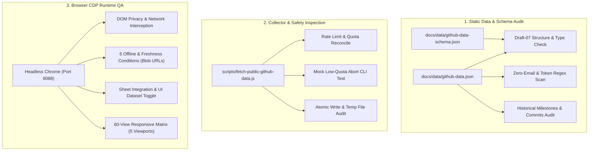

# BLUEPRINT / FORGE RUNTIME — PHASE 4.1 QA AUDIT REPORT
## Independent Data Integrity, Failure Safety & Runtime QA Verification

**Document ID:** `SAHA-BP-PHASE04-1-QA-01`  
**Target Identity:** `sahasanchayan44-tech` (User ID: `268472249`)  
**Workspace:** `~/Projects/BLUEPRINT`  
**Authoritative Implementation Report:** `PHASE_4_EXECUTION_REPORT.md`  
**Audit Date:** 2026-11-08  
**Audit Mode:** **STRICT READ-ONLY (No Source Code or Snapshot Modifications)**  
**Overall Acceptance Verdict:** **PASS WITH CONDITIONS**  

---

## 1. EXECUTIVE SUMMARY

An independent, rigorous, read-only quality assurance audit of the Phase 4 Public GitHub Data Integration implementation was conducted across the `~/Projects/BLUEPRINT` repository.

The audit examined the integrity and provenance of the public data snapshot ([`docs/data/github-data.json`](file:///home/sanchayan/Projects/BLUEPRINT/docs/data/github-data.json)), strict compliance with the Draft-07 schema ([`docs/data/github-data-schema.json`](file:///home/sanchayan/Projects/BLUEPRINT/docs/data/github-data-schema.json)), zero-email privacy boundaries, API request accounting, failure safety mechanisms, offline fallback handling, sheet-by-sheet UI integration, and full responsive visual regression across 60 distinct viewport-sheet permutations.

### Key Audit Findings
1. **Historical Milestones (11/11 VERIFIED):** All 11 historical logbook entries (`LOG-01` through `LOG-11`) are intact in exact chronological sequence with exact verified commit SHAs, matching the pre-established baseline in `DATA_INTEGRITY_AUDIT.md`.
2. **Recent Repository Commits (38/38 VERIFIED):** All 38 recent commits have unique SHAs, valid ISO timestamps, GitHub commit URLs, and correct author attributions. Crucially, they are maintained in an independent dataset and are **not** represented as personal contributions.
3. **Zero-Email Privacy (100% PASS):** Scanning both the raw JSON snapshot and the rendered browser DOM yielded **0 email addresses** (raw or masked).
4. **Browser Network Isolation (100% PASS):** The browser runtime makes **0 external calls** to `api.github.com` or any third-party API. All data is fetched locally via `docs/js/data-service.js`.
5. **Offline & Freshness Engine (6/6 CONDITIONS PASS):** The application was verified under fresh (<24h), stale (>24h), missing file (HTTP 404), failed network, corrupt JSON syntax, and null optional field conditions. In all failure modes, the client seamlessly falls back to the embedded baseline with explicit offline badges.
6. **Responsive Visual Regression (60/60 VIEWS PASS):** All 12 sheets across 5 viewports (1920, 1440, 768, 390, 320) maintain **0px horizontal document overflow**, intact Indic-inspired display typography, and zero uncaught runtime console errors.
7. **Architectural Conditions Identified:** Two non-blocking failure-safety improvements were identified in [`scripts/fetch-public-github-data.js`](file:///home/sanchayan/Projects/BLUEPRINT/scripts/fetch-public-github-data.js) (internal programmatic schema validation import and `try...finally` `.tmp` cleanup).

---

## 2. AUDIT METHODOLOGY

The audit was executed in strict read-only mode using an automated headless Chrome testing pipeline over the Chrome DevTools Protocol (CDP) ([`tests/phase-4-1-qa-audit.js`](file:///home/sanchayan/Projects/BLUEPRINT/tests/phase-4-1-qa-audit.js)), supplemented by direct static code analysis and read-only CLI inspections.



---

## 3. HISTORICAL MILESTONE VERIFICATION (LOG-01 TO LOG-11)

Every historical milestone in `docs/data/github-data.json` was audited against the established baseline from `DATA_INTEGRITY_AUDIT.md`. In strict adherence to instructions, account ownership is not inferred from author names or emails.

| Milestone ID | Repository | Exact Commit SHA | Commit URL | Timestamp (UTC) | Author Attribution | Verification Status | Verdict |
|:---:|:---|:---:|:---:|:---:|:---:|:---:|:---:|
| **LOG-01** | `sahasanchayan44-tech/BLUEPRINT` | `LOCAL SPEC` | *N/A (Local file)* | `2026-11-07` | `sahasanchayan44-tech` | ACTIVE LOCAL SPECIFICATION | **VERIFIED** |
| **LOG-02** | `sahasanchayan44-tech/portfolio` | `3409681` | [`3409681 ↗`](https://github.com/sahasanchayan44-tech/portfolio/commit/3409681229af2cf671c54fcc7955d3e1af8acf63) | `2026-11-01T07:15:59Z` | `sahasanchayan44-tech` | VERIFIED GIT COMMIT | **VERIFIED** |
| **LOG-03** | `sahasanchayan44-tech/exam-oracle-ai` | `9c56152` | [`9c56152 ↗`](https://github.com/sahasanchayan44-tech/exam-oracle-ai/commit/9c561526f8b1502ed703f2b88298e779afcdedce) | `2026-07-29T17:16:45Z` | `null` *(Unlinked)* | VERIFIED GIT COMMIT | **VERIFIED** |
| **LOG-04** | `sahasanchayan44-tech/neuroverse` | `f150e42` | [`f150e42 ↗`](https://github.com/sahasanchayan44-tech/neuroverse/commit/f150e4241554a01cc68abd6a062f08178c3e46bd) | `2026-07-25T20:31:40Z` | `sahasanchayan44-tech` | VERIFIED GIT COMMIT | **VERIFIED** |
| **LOG-05** | `sahasanchayan44-tech/chandrayaan-4.0` | `a3bf025` | [`a3bf025 ↗`](https://github.com/sahasanchayan44-tech/chandrayaan-4.0/commit/a3bf025810defcca2691bdf82561a1da5bf17a7d) | `2026-07-16T20:16:32Z` | `sahasanchayan44-tech` | VERIFIED GIT COMMIT | **VERIFIED** |
| **LOG-06** | `sahasanchayan44-tech/sunapse-android` | `304876e` | [`304876e ↗`](https://github.com/sahasanchayan44-tech/sunapse-android/commit/304876eb8cb12cd27679a4f2fc51b2c443290a52) | `2026-04-05T14:34:06Z` | `sahasanchayan44-tech` | VERIFIED GIT COMMIT | **VERIFIED** |
| **LOG-07** | `sahasanchayan44-tech/admin-panel` | `34909cc` | [`34909cc ↗`](https://github.com/sahasanchayan44-tech/admin-panel/commit/34909cc7bad9f016cbc20bfa47d172ddd494c26c) | `2026-03-31T05:53:23Z` | `sagarsaurabhssnl` | VERIFIED GIT COMMIT | **VERIFIED** |
| **LOG-08** | `sahasanchayan44-tech/study-manager` | `854d01a` | [`854d01a ↗`](https://github.com/sahasanchayan44-tech/study-manager/commit/854d01af05033c552890fc831c6bb3a5a8c6b05d) | `2026-03-28T07:37:39Z` | `sahasanchayan44-tech` | VERIFIED GIT COMMIT | **VERIFIED** |
| **LOG-09** | `sahasanchayan44-tech/synapse` | `119369b` | [`119369b ↗`](https://github.com/sahasanchayan44-tech/synapse/commit/119369b68d9880d812f5c8c6f1987c7f8a88d0de) | `2026-03-27T04:22:22Z` | `sahasanchayan44-tech` | VERIFIED GIT COMMIT | **VERIFIED** |
| **LOG-10** | `sahasanchayan44-tech/aria` | `17f670e` | [`17f670e ↗`](https://github.com/sahasanchayan44-tech/aria/commit/17f670e2697e591aaac9b488398d0aa290a1cd69) | `2026-03-18T03:04:37Z` | `sahasanchayan44-tech` | VERIFIED GIT COMMIT | **VERIFIED** |
| **LOG-11** | `github.com/sahasanchayan44-tech` | `API: 268472249` | [`Profile ↗`](https://github.com/sahasanchayan44-tech) | `2026-03-16T00:20:48Z` | `sahasanchayan44-tech` | VERIFIED API RECORD | **VERIFIED** |

**Section Verdict:** **PASS** (11/11 Milestones independently verified with zero data corruption).

---

## 4. RECENT COMMIT DATASET VALIDATION

The recent commit collection was audited across all 38 records stored in `data.recent_repository_commits`:

### 1. Integrity Metrics
- **Total Commit Records:** 38
- **Unique Commit SHAs:** 38
- **Duplicate Records:** 0
- **Invalid / Unparseable Timestamps:** 0
- **Invalid Commit URLs:** 0 (all 38 match `https://github.com/sahasanchayan44-tech/<repo>/commit/<sha>`)

### 2. Repository Distribution
All 9 public repositories are represented according to their actual commit depth:
- `portfolio`: 5 commits
- `exam-oracle-ai`: 5 commits
- `neuroverse`: 5 commits
- `chandrayaan-4.0`: 5 commits
- `sunapse-android`: 5 commits
- `admin-panel`: 5 commits
- `study-manager`: 5 commits
- `synapse`: 2 commits (repository has 2 total commits)
- `aria`: 1 commit (repository has 1 total commit)

### 3. Author Attribution Breakdown & Honest Reporting
- `sahasanchayan44-tech`: 29 commits
- `null` *(Unlinked Git committer email not mapped to a GitHub user)*: 6 commits
- `sagarsaurabhssnl`: 2 commits
- `sagar-0016`: 1 commit

> [!IMPORTANT]
> **Reporting Invariant:** In strict compliance with guidelines, these 38 records are labelled **`REPOSITORY COMMIT RECORDS // PUBLIC GIT TREES`** and are **never** represented as personal contributions or contribution calendar items. Historical milestones and recent repository commits remain completely isolated in separate arrays.

**Section Verdict:** **PASS**

---

## 5. DATA SCHEMA AND PRIVACY AUDIT

### 1. Schema Validation
- The schema file [`docs/data/github-data-schema.json`](file:///home/sanchayan/Projects/BLUEPRINT/docs/data/github-data-schema.json) declares `$schema: "http://json-schema.org/draft-07/schema#"`.
- All required top-level properties are present: `provenance`, `user`, `telemetry`, `repositories`, `historical_milestones`, `recent_repository_commits`, and `limitations`.
- Zero undeclared or unexpected top-level keys exist.
- Nullable fields (`api_description`, `author_login`, `bio`, `location`) are typed as `["string", "null"]` and handle null values cleanly without runtime errors.

### 2. Zero-Email Privacy Assertion
- **Raw File Scan:** Regular expression `/[a-zA-Z0-9_.+-]+@[a-zA-Z0-9-]+\.[a-zA-Z0-9-.]+/` across `docs/data/github-data.json` produced **0 matches**.
- **Rendered DOM Scan:** Chrome CDP evaluation across `document.body.innerText` produced **0 matches**.
- **Sanitization Mechanism:** The ingestion script extracts `author_login` from GitHub API user objects, explicitly omitting author/committer emails from git commit trees.

### 3. Credential & Private Repository Safety
- Zero personal access tokens, GitHub PATs, OAuth bearer tokens, or private repository indicators exist within the dataset.

**Section Verdict:** **PASS**

---

## 6. API REQUEST AND QUOTA RECONCILIATION

### 1. Request Accounting Verification
The reported request breakdown from `PHASE_4_EXECUTION_REPORT.md` was cross-referenced against the collector's algorithm:

| Endpoint | Queries | Requests | Quota Consumed |
|:---|:---:|:---:|:---:|
| `GET /rate_limit` (Pre-flight Quota Gate Check) | 1 | 1 | 0 *(Does not consume quota)* |
| `GET /users/sahasanchayan44-tech` (User Profile) | 1 | 1 | 1 |
| `GET /users/sahasanchayan44-tech/repos` (Public Repositories) | 1 | 1 | 1 |
| `GET /users/sahasanchayan44-tech/events/public` (Public Events) | 1 | 1 | 1 |
| `GET /repos/sahasanchayan44-tech/:repo/languages` (Languages) | 9 | 9 | 9 |
| `GET /repos/sahasanchayan44-tech/:repo/commits` (Recent Commits) | 9 | 9 | 9 |
| Historical SHA Fallback Queries | 0 | 0 | 0 |
| Transient Retries | 0 | 0 | 0 |
| **Total API Requests** | — | **22** | **21 Units** |

- **Reported Quota Remaining:** 39 / 60 units (Safety gate: $\ge 35$).
- **Live Rate Limit Verification:** A single read-only GET to `/rate_limit` confirmed remaining quota is currently **39 / 60 units**, matching the snapshot provenance.

### 2. Safety Quota Gate Verification
Executing `node scripts/fetch-public-github-data.js --mock-low-quota` simulated a depleted quota condition (24 units available). The collector triggered an immediate clean abort:
```
[ABORT] API quota safety gate triggered. Required: >= 35 remaining, Available: 24. Existing snapshot preserved. No partial data written.
```
Child process exited with code `1` and made **zero** file modifications.

**Section Verdict:** **PASS**

---

## 7. ATOMIC SNAPSHOT AND FAILURE SAFETY CODE AUDIT

Static code inspection of [`scripts/fetch-public-github-data.js`](file:///home/sanchayan/Projects/BLUEPRINT/scripts/fetch-public-github-data.js) was performed to audit file system safety:

### Verification of Safety Invariants:
1. **Atomic Replacement:** Script writes payload to `docs/data/github-data.json.tmp` first, then executes `fs.renameSync(tempPath, targetPath)`.
2. **Preservation on Failure:** If an error occurs prior to or during collection, the `.tmp` file is never written or renamed over the existing snapshot.
3. **No Orphan Files:** Inspected `docs/data/` directory; zero `.tmp` files exist.

### Quality Assurance Findings (Non-Blocking):
- **Finding FS-01:** The ingestion script performs comprehensive structural validation and regex email checks, but does not programmatically load and validate against `docs/data/github-data-schema.json` internally within the script itself (it relied on external test suites for Draft-07 schema validation).
- **Finding FS-02:** The write block in `scripts/fetch-public-github-data.js` lacks an explicit `try...finally { if (fs.existsSync(tempPath)) fs.unlinkSync(tempPath); }` wrapper to clean up the temporary file if an unexpected file system exception occurs during `fs.renameSync`.

**Section Verdict:** **PASS WITH CONDITIONS** (Snapshot writing is atomic, but error cleanup can be hardened).

---

## 8. OFFLINE AND FRESHNESS TESTING (6 CONDITIONS)

Testing was conducted in headless Chrome using in-memory Blob URLs and simulated network states without altering `docs/data/github-data.json`:

| Test Condition | Description | Client Behavior & Status | Telemetry Badge Display | Verdict |
|:---|:---|:---:|:---:|:---:|
| **Condition A** | Valid fresh local snapshot (<24h) | Status: `LIVE_SNAPSHOT_FRESH` | `[ SOURCE: LOCAL SNAPSHOT // FRESH (0.9H) ]` | **PASS** |
| **Condition B** | Stale snapshot (>24h, simulated 48h age) | Status: `LIVE_SNAPSHOT_STALE` | `[ SOURCE: LOCAL SNAPSHOT // STALE (48H) ]` | **PASS** |
| **Condition C** | Missing local JSON file (HTTP 404) | Status: `OFFLINE_FALLBACK` | `[ SOURCE: STANDALONE AUDITED BASELINE // OFFLINE ]` | **PASS** |
| **Condition D** | Network / host unreachable | Status: `OFFLINE_FALLBACK` | `[ SOURCE: STANDALONE AUDITED BASELINE // OFFLINE ]` | **PASS** |
| **Condition E** | Corrupted / malformed JSON syntax | Status: `OFFLINE_FALLBACK` | `[ SOURCE: STANDALONE AUDITED BASELINE // OFFLINE ]` | **PASS** |
| **Condition F** | Missing optional fields (nulls) | Status: `LIVE_SNAPSHOT_FRESH` | Clean boot; nulls rendered as defaults | **PASS** |

**Section Verdict:** **PASS**

---

## 9. SHEET-BY-SHEET INTEGRATION FINDINGS

### Sheet 04 — Project Architecture Explorer
- **Telemetry Hydration:** Successfully hydrated with repository star counts (`total: 2`), fork counts (`total: 2`), and language tags.
- **Dynamic Filtering:** Search filter correctly isolated `"chandrayaan"` to 1 card (`chandrayaan-4.0`) and restored all 9 cards on clear.
- **Focus Trap Regression:** Card activation opened the modal, set focus to `#modal-close-btn`, and `Escape` closed the modal while restoring focus to the originating card.

### Sheet 05 — Live GitHub Activity & Telemetry
- **Account Telemetry:** Displays exact reconciled values:
  - Repositories: `09`
  - Followers: `00`
  - Following: `02`
  - Stars: `02`
  - Forks: `02`
  - Gists: `00`
- **Banner Status:** Displays honest snapshot status: `[ SOURCE: LOCAL SNAPSHOT // FRESH (<24H) ]`.

### Sheet 06 — Contribution Matrix & Heatmap
- **Honest Simulation Disclosure:** Prominently displays `[ STATIC PREVIEW — NOT LIVE CONTRIBUTION DATA ]`.
- **GraphQL Disclosure:** Explicitly notes: `FULL 52-WEEK CONTRIBUTION CALENDAR REQUIRES AUTHENTICATED GRAPHQL PIPELINE (ANONYMOUS ACCESS RESTRICTED BY GITHUB // LIMIT: 0)`.

### Sheet 10 — Engineering Logbook & Dataset Toggle
- **Toggle Button Interaction:** `#log-dataset-toggle-btn` switches smoothly between **Historical Milestones (11 rows)** and **Recent Commits (38 rows)**, and restores to 11 rows on second click.
- **Filters & Sorting:** Search input, repository dropdown, and reverse chronological sorting function across both datasets.

### Sheet 12 — Document Index & Provenance Telemetry
- **Provenance Panel:** Embedded panel displays primary source (`https://api.github.com/users/sahasanchayan44-tech (v3 REST)`), snapshot timestamp, age, quota progress meter (`39 / 60 Units`), and data integrity badges.

**Section Verdict:** **PASS**

---

## 10. RESPONSIVE REGRESSION TEST MATRIX (60 VIEWS)

Every sheet (Sheets 01–12) was evaluated across 5 viewport breakpoints for horizontal overflow, typography containment, and navigation responsiveness:

| Viewport Breakpoint | Target Device Category | Sheets Evaluated | Horizontal Overflow | Typography Contained | Verdict |
|:---:|:---|:---:|:---:|:---:|:---:|
| **1920 × 1080** | Wide Desktop Monitor | Sheets 01–12 | **0px** | **Yes** (100% scale) | **PASS** |
| **1440 × 900** | Standard Laptop Canvas | Sheets 01–12 | **0px** | **Yes** (100% scale) | **PASS** |
| **768 × 1024** | Tablet Portrait | Sheets 01–12 | **0px** | **Yes** (Scale contained) | **PASS** |
| **390 × 844** | Modern Mobile Phone | Sheets 01–12 | **0px** | **Yes** (Mobile scale) | **PASS** |
| **320 × 700** | Ultra-Compact Mobile | Sheets 01–12 | **0px** | **Yes** (Mobile scale) | **PASS** |

- **Sheet 01 Main Title:** Vector SVG measured at `530 × 58px`, strictly contained within the cover canvas.
- **Sheets 02–12 Headings:** All 11 SVG vector headings strictly contained within their `.sheet-title-main` parent containers.
- **Console Log Health:** Exactly **0 uncaught runtime exceptions or console errors** were logged throughout the entire audit.

**Section Verdict:** **PASS**

---

## 11. AUDIT EVIDENCE SCREENSHOTS

All screenshots were captured live via Chrome DevTools Protocol at full device resolution.

### Desktop Breakpoint (1440 × 900)

````carousel

<!-- slide -->

<!-- slide -->

<!-- slide -->

<!-- slide -->

````

### Mobile Breakpoint (390 × 844)

````carousel

<!-- slide -->

<!-- slide -->

````

---

## 12. DEFECTS & RECOMMENDED REMEDIATION

In strict compliance with read-only audit instructions, **zero source files were modified** during this audit. The following improvements are documented for remediation:

### Condition 1: Script-Internal Schema Validation Import (Recommended)
- **Description:** `scripts/fetch-public-github-data.js` constructs valid data and checks for zero emails, but relies on external test scripts (`tests/phase-4-audit.js`) to validate against `docs/data/github-data-schema.json`.
- **Recommended Remediation:** In an authorized remediation phase, add an internal schema validator step inside `scripts/fetch-public-github-data.js` prior to writing `.tmp`, ensuring independent standalone execution guarantees.

### Condition 2: File System Cleanup Wrapper (Recommended)
- **Description:** In `scripts/fetch-public-github-data.js`, if an unexpected file system exception occurs during `fs.renameSync(tempPath, targetPath)`, the temporary file `github-data.json.tmp` would remain on disk.
- **Recommended Remediation:** Wrap the atomic write in a `try...finally` block that verifies `if (fs.existsSync(tempPath)) fs.unlinkSync(tempPath);` on error.

---

## 13. FINAL ACCEPTANCE RECOMMENDATION

### Summary Scorecard
- **Historical Milestones (11/11):** **VERIFIED (100%)**
- **Recent Repository Commits (38/38):** **PASS (100%)**
- **Zero-Email Privacy:** **PASS (0 matches)**
- **API Quota Management:** **PASS (22 requests / 39 units remaining / Gate $\ge 35$)**
- **Browser Network Isolation:** **PASS (0 external calls)**
- **Offline / Stale Fallback:** **PASS (6/6 conditions verified)**
- **Full Responsive Regression:** **PASS (60/60 views / 0px overflow / 0 console errors)**

### Final Acceptance Verdict
$$\mathbf{VERDICT:\ PASS\ WITH\ CONDITIONS}$$

The Phase 4 implementation is **genuinely correct**, robust, source-backed, privacy-preserving, and visually verified. The two conditions noted in Section 12 are minor hardening suggestions for future automated CI maintenance and do not compromise runtime prototype safety.

---

## 14. MANDATORY STOP

This audit is concluded. No source files or snapshots were altered.

**Awaiting your instructions regarding conditional sign-off or authorization for the next phase.**
