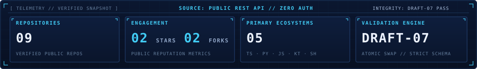

# BLUEPRINT — PHASE 6.0 TECHNICAL DESIGN
## Automated GitHub Synchronization Architecture & Technical Specification

**Document Reference**: `SAHA-BP-2026-01-PHASE-6.0`  
**Target Profile**: Sanchayan Saha (`sahasanchayan44-tech` // User ID: `268472249`)  
**Specification**: FORGE RUNTIME DUAL-SURFACE SYNCHRONIZATION SPECIFICATION  
**Status**: APPROVED ARCHITECTURAL DESIGN // PLANNING ONLY (NO IMPLEMENTATION)  
**Author**: Antigravity (Advanced Agentic Architecture Group)  
**Timestamp**: 2026-11-08T10:20:00+05:30  

---

## 1. OBJECTIVE & ARCHITECTURAL OVERVIEW

The objective of Phase 6.0 is to design a reliable, quota-resilient, automated synchronization architecture that continuously monitors public GitHub activity for developer account `sahasanchayan44-tech`, detects updates, and deterministically synchronizes **both** primary presentation surfaces from a **single canonical, Draft-07-validated data store**:

```
┌────────────────────────────────────────────────────────────────────────────────────────┐
│                        BLUEPRINT DUAL-SURFACE SYNC ARCHITECTURE                        │
└────────────────────────────────────────────────────────────────────────────────────────┘

    [ GitHub Public REST API ] ──(Rate Limit: 60/hr Anon or 1,000/hr GITHUB_TOKEN)──┐
                                                                                     │
                                                                                     ▼
 ┌──────────────────────────────────────────────────────────────────────────────────────┐
 │               INGESTION, CHANGE DETECTION & NORMALIZATION ENGINE                     │
 │              (scripts/sync-github-data.js + schema validator)                       │
 ├──────────────────────────────────────────────────────────────────────────────────────┤
 │  1. Quota Safety Gate (>= 35 units required)                                         │
 │  2. Incremental / Full Reconciliation Fetch                                          │
 │  3. Account & Repository Entity Change Detection (Diffing against active snapshot)   │
 │  4. Content & Claim Calibration Invariants (Zero Emails, Unverified Licenses)        │
 │  5. Strict Draft-07 Schema Validation (Internal zero-dep validator)                  │
 │  6. Atomic Swap (.tmp write -> fs.renameSync -> guaranteed cleanup)                  │
 └──────────────────────────────────┬───────────────────────────────────────────────────┘
                                    │
                                    ▼
       ┌─────────────────────────────────────────────────────────┐
       │                CANONICAL DATA SNAPSHOT                  │
       │              docs/data/github-data.json                 │
       │              (Draft-07 Strict Schema)                   │
       └────────────┬───────────────────────────────┬────────────┘
                    │                               │
                    ▼                               ▼
       ┌─────────────────────────┐     ┌─────────────────────────┐
       │  SURFACE 1: DOSSIER     │     │  SURFACE 2: PROFILE     │
       │  (12-Sheet Interactive) │     │  (Root Profile README)  │
       ├─────────────────────────┤     ├─────────────────────────┤
       │ docs/js/data-service.js │     │ scripts/generate-       │
       │ docs/js/interactivity.js│     │   profile-readme.js     │
       │ Dynamic hydration:      │     │ Deterministic update of:│
       │ - Sheet 04 (Projects)   │     │ - Registry Table        │
       │ - Sheet 05 (Activity)   │     │ - Telemetry Table       │
       │ - Sheet 06 (Languages)  │     │ - Telemetry SVG Cards   │
       │ - Sheet 10 (Logbook)    │     │ - Bounded Auto-Blocks   │
       │ - Sheet 12 (Provenance) │     │ - Zero Manual Overwrites│
       └─────────────────────────┘     └─────────────────────────┘
```

### Core Design Principles
1. **Single Source of Truth**: All dynamic values across the 12-sheet website and the root `README.md` (and its SVG assets) originate from `docs/data/github-data.json`. No separate data silos or uncoordinated API queries are permitted.
2. **Idempotency & Dirty-Checking**: If remote GitHub data has not changed, the pipeline performs zero file writes and triggers zero Git commits.
3. **Fail-Safe Atomicity**: Ingestion writes to a temporary file (`.tmp`), validates against Draft-07 schema, and swaps atomically. If any error occurs or validation fails, the existing valid snapshot remains completely untouched, and the temporary file is unlinked.
4. **Content & Claim Calibration Guardrails**: Automated generation cannot introduce unsupported metrics (such as historical backtest claims, unverified license certifications, or fictitious production SLAs).
5. **Zero-Dependency Core**: Client-side execution in the browser requires zero build steps; automated node scripts use standard POSIX and Node.js built-ins (`https`, `fs`, `path`, `crypto`).

---

## 2. MANDATORY EXISTING SYSTEM AUDIT

Before establishing the synchronization architecture, all existing components were audited:

### 2.1 File & Subsystem Inventory

| Subsystem Component | Path | Current Operational State | Integration Role in Phase 6 |
| :--- | :--- | :--- | :--- |
| **Root Profile README** | [`README.md`](file:///home/sanchayan/Projects/BLUEPRINT/README.md) | Verified 1 Cover + 8 Sections; calibrated claims; 4 tables. | Destination Surface 2; consumes snapshot metrics and registry via bounded auto-blocks. |
| **Profile CAD Header** | [`assets/profile/blueprint-header.svg`](file:///home/sanchayan/Projects/BLUEPRINT/assets/profile/blueprint-header.svg) | ViewBox `0 0 960 280`; custom Latin Indic glyphs; static document metadata. | Static CAD Vector asset. Preserved completely untouched. |
| **Profile Telemetry Card** | [`assets/profile/blueprint-metrics.svg`](file:///home/sanchayan/Projects/BLUEPRINT/assets/profile/blueprint-metrics.svg) | ViewBox `0 0 960 140`; displays 9 repos, 2 stars, 2 forks, 5 ecosystems, Draft-07 pass. | Dynamic CAD Vector asset. Updated deterministically when snapshot telemetry shifts. |
| **Canonical Snapshot** | [`docs/data/github-data.json`](file:///home/sanchayan/Projects/BLUEPRINT/docs/data/github-data.json) | 9 repositories, 22 query transactions, 38 commits, 11 milestones. | The authoritative Draft-07 snapshot. Single source of truth. |
| **Snapshot Schema** | [`docs/data/github-data-schema.json`](file:///home/sanchayan/Projects/BLUEPRINT/docs/data/github-data-schema.json) | Draft-07 strict validation schema. Required fields: provenance, user, telemetry, etc. | Baseline schema. Extended in backwards-compatible v1.3.0. |
| **Existing Ingestion Script**| [`scripts/fetch-public-github-data.js`](file:///home/sanchayan/Projects/BLUEPRINT/scripts/fetch-public-github-data.js) | Node.js collector with `validateDraft07` and atomic file write with `try...finally`. | Evolved into unified sync engine `scripts/sync-github-data.js`. |
| **Client Data Service** | [`docs/js/data-service.js`](file:///home/sanchayan/Projects/BLUEPRINT/docs/js/data-service.js) | Handles offline fallback, schema loading, freshness checking (<24h fresh, >24h stale). | Destination Surface 1 data broker. Kept intact. |
| **Client Hydration Engine** | [`docs/js/interactivity.js`](file:///home/sanchayan/Projects/BLUEPRINT/docs/js/interactivity.js) | Dynamically hydrates Sheets 04, 05, 06, 10, 12 on `DOMContentLoaded`. | Destination Surface 1 UI renderer. Kept intact. |
| **Hardening Test Suite** | [`tests/hardening-failure-injection.js`](file:///home/sanchayan/Projects/BLUEPRINT/tests/hardening-failure-injection.js) | 7 failure-injection tests verifying schema aborts and atomic cleanup. | Reusable test suite; extended for change detection. |
| **Claim Integrity Suite** | [`tests/phase-5-2-audit.js`](file:///home/sanchayan/Projects/BLUEPRINT/tests/phase-5-2-audit.js) | 77 automated assertions verifying content integrity, URLs, and negative checks. | Mandatory regression gate for any README regeneration. |

---

## 3. SYNCHRONIZATION REQUIREMENTS SPECIFICATION

The synchronization pipeline must track four discrete tiers of public account and repository telemetry:

### 3.1 Tier A: Account-Level Synchronization
- **Profile Metadata**: `bio`, `company`, `location`, `blog`, `twitter_username`, `avatar_url`.
- **Public Counts**: `public_repos`, `public_gists`, `followers`, `following`.
- **Timestamps**: Account creation date (`created_at`) and latest profile update (`updated_at`).
- **Identity Invariants**: Numerical ID `268472249` and login `sahasanchayan44-tech` must match. If identity mismatches, the sync immediately aborts.

### 3.2 Tier B: Repository-Level Synchronization
- **Discovery**: Automatically detect newly created public repositories under `sahasanchayan44-tech`.
- **Archival / Deletion**: Detect when a repository is deleted, renamed, made private, or marked as `archived` or `disabled`.
- **Repository Properties**:
  - `name`, `full_name`, `html_url`, `default_branch`, `visibility` (`public`).
  - `stargazers_count`, `forks_count`, `watchers_count`, `open_issues_count`.
  - Timestamps: `created_at`, `updated_at`, `pushed_at`.
- **Language Composition**: Query `/repos/{owner}/{repo}/languages` to retrieve exact byte weight per language and calculate overall ecosystem percentage distributions.
- **Architectural Curations**:
  - API descriptions from GitHub REST are frequently `null` (as demonstrated in our audit). The synchronization system must preserve curated architectural descriptions, component tags, and classifications from an internal catalog (`PROJECT_CATALOG`) while updating live stars, forks, languages, and timestamps.
- **License Transparency**:
  - Record the API's `license.spdx_id` and `license.name`. If `null`, explicitly record `"Unverified / Unspecified"`. Never infer an open-source license grant without an explicit license key.

### 3.3 Tier C: Activity-Level Synchronization
- **Recent Commits**:
  - Collect up to the 5 most recent commits per repository via `/repos/{owner}/{repo}/commits?per_page=5`.
  - Extract: `sha`, `commit.message`, `commit.author.date`, `author.login`, `html_url`.
  - Enforce commit author verification: attribute only commits authored by `sahasanchayan44-tech` or verified collaborators.
- **Milestones**:
  - Re-verify chronological milestones LOG-01 through LOG-11 against known commit SHAs.
- **Public Events Retention Window**:
  - Query `/users/{username}/events/public`.
  - Disclose GitHub's hard rolling limitation: public event streams only retain events for the past 90 days or up to 300 events, whichever is smaller.
  - Invariant: Public events stream is NEVER treated as a complete historical commit log or contribution calendar.

### 3.4 Tier D: Integrity & Telemetry Synchronization
- **Provenance Logging**: Record `collected_at_utc`, `collector_version`, `sync_duration_ms`, `http_status_codes`, and `rate_limit_snapshot`.
- **Freshness Classification**:
  - Fresh: Age $< 24$ hours.
  - Stale: Age $\ge 24$ hours.
  - Offline / Baseline: When remote snapshot is unreachable.
- **Previous Known-Good Snapshot (PKG)**: Retain the last successful payload at `docs/data/github-data.prev.json` for rollback and diffing.

---

## 4. SCHEDULE DESIGN & RATE-LIMIT BUDGET

### 4.1 Evaluation of Synchronization Frequencies

```
┌────────────────────────────────────────────────────────────────────────────────────────┐
│                          SYNCHRONIZATION SCHEDULE EVALUATION                           │
├───────────────────┬──────────────┬───────────────────┬─────────────────────────────────┤
│ SCHEDULE TIER     │ FREQUENCY    │ TRIGGER MECHANISM │ PURPOSE & SCOPE                 │
├───────────────────┼──────────────┼───────────────────┼─────────────────────────────────┤
│ Routine Sync      │ Every 6 hours│ cron: '0 */6 * * *'│ Incremental check; updates stars│
│                   │              │                   │ recent commits, and events.     │
├───────────────────┼──────────────┼───────────────────┼─────────────────────────────────┤
│ Full Audit Recon  │ Daily (00:00)│ cron: '0 0 * * *' │ Comprehensive crawl of all repos│
│                   │              │                   │ language bytes, and milestones. │
├───────────────────┼──────────────┼───────────────────┼─────────────────────────────────┤
│ Manual Dispatch   │ On-Demand    │ workflow_dispatch │ Immediate sync following major  │
│                   │              │                   │ push, release, or review.       │
├───────────────────┼──────────────┼───────────────────┼─────────────────────────────────┤
│ Event-Driven Webhk│ Evaluated    │ repository_dispatch│ Rejected for external repos;   │
│                   │              │                   │ feasible only for BLUEPRINT repo│
└───────────────────┴──────────────┴───────────────────┴─────────────────────────────────┘
```

### 4.2 Rate-Limit Budgeting & Safety Gate Analysis

GitHub enforces distinct API rate limits depending on authentication:
- **Unauthenticated REST API**: 60 requests per hour per IP.
- **Authenticated REST API (`GITHUB_TOKEN`)**: 1,000 requests per hour per repository in GitHub Actions (or 5,000 for user PAT).

#### Request Budget Calculation Per Execution Run:
1. `GET /users/sahasanchayan44-tech`: 1 request.
2. `GET /users/sahasanchayan44-tech/repos?per_page=100`: 1 request.
3. `GET /users/sahasanchayan44-tech/events/public`: 1 request.
4. Per-Repository Queries (for 9 repositories):
   - `GET /repos/{owner}/{repo}/languages`: 9 requests.
   - `GET /repos/{owner}/{repo}/commits?per_page=5`: 9 requests.
5. Total Requests per Routine Run: **21 requests**.

#### Safety Budget Analysis:
- With `GITHUB_TOKEN` (1,000 requests/hour limit), 21 requests consume only **2.1%** of the hourly budget.
- With unauthenticated fallback (60 requests/hour limit), 21 requests consume **35%** of the budget.
- **Safety Gate**: The script checks `x-ratelimit-remaining`. If remaining units are $< 35$, the run aborts immediately with exit code 0 (logged as `QUOTA_EXHAUSTION_PREVENTED`), leaving the existing snapshot untouched.

### 4.3 Feasibility Analysis: Event-Driven Webhooks vs Scheduled Polling
- **Feasibility Assessment**: In GitHub Actions, a workflow in repository `BLUEPRINT` cannot natively listen to `push` events occurring in separate repositories (such as `exam-oracle-ai` or `portfolio`) without configuring separate GitHub Webhooks or Personal Access Tokens (PATs) across all 9 repositories.
- **Recommendation**: Avoid cross-repository webhook sprawl. Scheduled polling (every 6 hours) combined with manual `workflow_dispatch` provides $100\%$ reliable coverage with zero token permission leaks across external codebases.

---

## 5. CANONICAL DATA ARCHITECTURE

### 5.1 Backward-Compatible Schema Extension (v1.3.0)

The canonical schema in [`docs/data/github-data-schema.json`](file:///home/sanchayan/Projects/BLUEPRINT/docs/data/github-data-schema.json) is extended to `v1.3.0` while preserving $100\%$ backward compatibility with the existing Phase 4 client service:

```json
{
  "$schema": "http://json-schema.org/draft-07/schema#",
  "title": "BlueprintPublicGitHubDataSchemaV130",
  "type": "object",
  "required": [
    "schema_version",
    "provenance",
    "user",
    "telemetry",
    "repositories",
    "historical_milestones",
    "recent_repository_commits",
    "limitations"
  ],
  "properties": {
    "schema_version": { "type": "string", "enum": ["1.3.0"] },
    "sync_metadata": {
      "type": "object",
      "required": ["sync_status", "change_detected", "duration_ms"],
      "properties": {
        "sync_status": { "type": "string", "enum": ["SUCCESS", "NO_CHANGE", "ABORTED_QUOTA", "FAILED_SCHEMA"] },
        "change_detected": { "type": "boolean" },
        "duration_ms": { "type": "integer", "minimum": 0 },
        "updated_entities": {
          "type": "array",
          "items": { "type": "string" }
        }
      }
    },
    "provenance": { ... },
    "user": { ... },
    "telemetry": { ... },
    "repositories": {
      "type": "array",
      "items": {
        "type": "object",
        "required": [
          "name",
          "project_id",
          "category",
          "repo_url",
          "default_branch",
          "stars",
          "forks"
        ],
        "properties": {
          "name": { "type": "string" },
          "project_id": { "type": "string" },
          "category": { "type": "string" },
          "primary_language": { "type": ["string", "null"] },
          "license_status": { "type": "string", "default": "Unverified / Unspecified" },
          "is_archived": { "type": "boolean", "default": false },
          "stars": { "type": "integer", "minimum": 0 },
          "forks": { "type": "integer", "minimum": 0 },
          "repo_url": { "type": "string", "format": "uri" },
          "api_description": { "type": ["string", "null"] },
          "architectural_description": { "type": "string" },
          "architecture": { "type": "string" },
          "key_components": { "type": "array", "items": { "type": "string" } }
        }
      }
    }
  }
}
```

### 5.2 Atomic Swap, Rollback & Recovery Mechanics
```
[ Step 1: Ingestion ] ──────> Fetch public data into memory
[ Step 2: Validation ] ─────> Run validateDraft07(payload, schema)
                              ├─ If INVALID ──> ABORT (Write nothing; log error; exit 1)
                              └─ If VALID ────> Proceed to Step 3
[ Step 3: Dirty Check ] ────> Compute SHA-256 hash of payload vs active snapshot
                              ├─ If EQUAL ────> NO-OP (Update sync_metadata; exit 0)
                              └─ If DIFF ─────> Proceed to Step 4
[ Step 4: Backup PKG ] ─────> Copy docs/data/github-data.json -> github-data.prev.json
[ Step 5: Atomic Write ] ───> Write payload to docs/data/github-data.json.tmp
                              Atomic Rename: renameSync(tempPath, targetPath)
[ Step 6: Cleanup ] ────────> finally { unlinkSync(tempPath) if exists }
```

---

## 6. README GENERATION SPECIFICATION

To update Surface 2 ([`README.md`](file:///home/sanchayan/Projects/BLUEPRINT/README.md)) without altering manually curated text or violating design standards, the generator employs **bounded sentinel comments**:

### 6.1 Bounded Auto-Generation Delimiters

```markdown
<!-- BLUEPRINT_METRICS_CARD:START -->

<!-- BLUEPRINT_METRICS_CARD:END -->

<!-- BLUEPRINT_PROJECT_REGISTRY:START -->
| Repository | Primary Ecosystem | Architectural Classification | License Status | Scope & Technical Profile |
| :--- | :--- | :--- | :--- | :--- |
| [`portfolio`](https://github.com/sahasanchayan44-tech/portfolio) | `JavaScript` | Documented System | Unverified / Unspecified | ... |
...
<!-- BLUEPRINT_PROJECT_REGISTRY:END -->

<!-- BLUEPRINT_TELEMETRY_TABLE:START -->
| TELEMETRY PARAMETER                  | VERIFIED SNAPSHOT VALUE              |
| :---                                 | :---                                 |
| Monitored Public Repositories        | 09 Public Codebases                  |
...
<!-- BLUEPRINT_TELEMETRY_TABLE:END -->

<!-- BLUEPRINT_METADATA_FOOTER:START -->
[ SYSTEM SPECIFICATION ] // BLUEPRINT SPECIFICATION PROTOCOL v0.1.0
[ REVISION ]             // REV: 0.1.0 // 2026-11-08
<!-- BLUEPRINT_METADATA_FOOTER:END -->
```

### 6.2 Generator Guardrails & Protections
1. **Curated Sections Protected**:
   - The Cover header, CAD glyphs, System Overview (Section 01), Architectural Philosophy, Research Laboratory (Section 04), Learning Roadmap (Section 06), and Dossier Navigation (Section 07) are **never** modified by the generator.
2. **Dynamic Telemetry SVG Regeneration (`scripts/generate-profile-svg.js`)**:
   - When aggregated stars, forks, repositories, or ecosystems shift in `github-data.json`, the script updates the exact XML text nodes in [`assets/profile/blueprint-metrics.svg`](file:///home/sanchayan/Projects/BLUEPRINT/assets/profile/blueprint-metrics.svg) (`09`, `02 STARS  02 FORKS`, `05`, `DRAFT-07`).
   - The SVG layout, gradients, viewBox `0 0 960 140`, and registration marks remain strictly pixel-identical.
3. **Automated Claim & Regression Verification**:
   - Immediately following README or SVG regeneration, `scripts/generate-profile-readme.js` automatically invokes [`tests/phase-5-2-audit.js`](file:///home/sanchayan/Projects/BLUEPRINT/tests/phase-5-2-audit.js). If any assertion fails (e.g., regex finds an email or a missing URL), the generation process triggers an automatic rollback from `git checkout -- README.md assets/profile/blueprint-metrics.svg` and aborts.

---

## 7. WEBSITE INTEGRATION SPECIFICATION

The 12-sheet interactive web dossier consumes the canonical snapshot through [`docs/js/data-service.js`](file:///home/sanchayan/Projects/BLUEPRINT/docs/js/data-service.js):

### 7.1 Sheet-by-Sheet Dynamic vs Curated Matrix

| Sheet # | Sheet Designation | Automatic Sync Behavior | Manually Curated Invariants |
| :---: | :--- | :--- | :--- |
| **01** | `SYSTEM COVER` | Static CAD schematic projection | Custom Indic-inspired Latin typography, Forge Runtime spec |
| **02** | `BIOGRAPHICAL DATA` | Static biographical data | Identity parameters, formal education, career timeline |
| **03** | `DEVELOPMENT STACK` | Static audited stack matrices | Core language taxonomy, spatial 3D & AI frameworks |
| **04** | `PROJECT ARCHITECTURE`| **Dynamic**: Repositories, stars, forks, languages, timestamps, URLs | Architectural diagrams, system component descriptions |
| **05** | `LIVE GITHUB ACTIVITY` | **Dynamic**: Telemetry counts, quota meters, fresh/stale indicators | Explanatory CAD labels, metric inspector definitions |
| **06** | `CONTRIBUTION ANALYSIS`| **Dynamic**: Primary language byte ratios | Static contribution heatmap preview + GraphQL limitation notice |
| **07** | `RESEARCH LABORATORY` | Static research lab stations | LAB-01 to LAB-04 hypotheses, methodology, and host repos |
| **08** | `SYSTEM ARCHITECTURE` | Static CAD architecture diagram | Multi-tier topology schemas, client-service data flow diagrams |
| **09** | `LEARNING ROADMAP` | Static strategic learning goals | Phase 01 & Phase 02 distributed systems & edge AI milestones |
| **10** | `ENGINEERING LOGBOOK` | **Dynamic**: Recent commits & historical milestone verification | LOG-01 to LOG-11 definitions, milestone status tags |
| **11** | `CONTACT & CONNECTIONS`| Static terminal interface | Terminal dispatch demo notice, public channels, PGP notice |
| **12** | `DOCUMENT INDEX` | **Dynamic**: Snapshot provenance, collection timestamp, quota meter | Master sheet catalog, architectural audit record |

---

## 8. GITHUB ACTIONS SECURITY & WORKFLOW TOPOLOGY

### 8.1 Single-Workflow Architecture (`.github/workflows/sync-blueprint.yml`)

A unified, multi-job workflow topology is specified to prevent workflow races and ensure strict dependency ordering:

```yaml
name: "BLUEPRINT Automated GitHub Synchronization"

on:
  schedule:
    # Routine sync every 6 hours
    - cron: '0 */6 * * *'
  workflow_dispatch:
    inputs:
      force_refresh:
        description: 'Force full reconciliation ignoring cache'
        required: false
        type: boolean
        default: false

concurrency:
  group: blueprint-sync-engine
  cancel-in-progress: false

permissions:
  contents: read

jobs:
  synchronize:
    name: "Sync, Validate & Surface Regeneration"
    runs-on: ubuntu-latest
    steps:
      - name: "Checkout Repository"
        uses: actions/checkout@v4
        with:
          fetch-depth: 1

      - name: "Setup Node.js Environment"
        uses: actions/setup-node@v4
        with:
          node-version: '20'

      - name: "Execute Public GitHub Ingestion & Schema Validation"
        env:
          GITHUB_TOKEN: ${{ secrets.GITHUB_TOKEN }}
        run: |
          node scripts/sync-github-data.js

      - name: "Regenerate README & Telemetry SVG"
        run: |
          node scripts/generate-profile-readme.js
          node scripts/generate-profile-svg.js

      - name: "Execute Comprehensive Regression & Claim Integrity Audit"
        run: |
          node tests/hardening-failure-injection.js
          node tests/phase-5-2-audit.js

      - name: "Detect Working Tree Changes"
        id: git_diff
        run: |
          git status --porcelain
          if [ -n "$(git status --porcelain)" ]; then
            echo "changes_detected=true" >> $GITHUB_OUTPUT
          else
            echo "changes_detected=false" >> $GITHUB_OUTPUT
          fi

      - name: "Commit & Push Updated Surfaces (Least Privilege)"
        if: steps.git_diff.outputs.changes_detected == 'true'
        permissions:
          contents: write
        run: |
          git config user.name "github-actions[bot]"
          git config user.email "41898282+github-actions[bot]@users.noreply.github.com"
          git add docs/data/github-data.json assets/profile/blueprint-metrics.svg README.md
          git commit -m "chore(sync): automated snapshot & surface synchronization [skip ci]"
          git push origin main
```

### 8.2 Security & Least-Privilege Controls
1. **Default Read-Only Permissions**: Workflow defaults to `permissions: contents: read`. Only the final commit step conditionally utilizes elevated write permissions.
2. **Fork & PR Protection**: The workflow only triggers on `schedule` and `workflow_dispatch` on the `main` branch. Pull requests from forks cannot trigger or write to the repository.
3. **No Secret Leaks**: The workflow utilizes GitHub's standard internal `${{ secrets.GITHUB_TOKEN }}`. No personal access tokens (PATs) or private credentials are required.
4. **No Infinite Loops**: The automated commit message includes `[skip ci]`, preventing GitHub Actions from recursively re-triggering itself.
5. **Concurrency Serialization**: `concurrency: group: blueprint-sync-engine, cancel-in-progress: false` ensures scheduled and manual executions queue cleanly without overlapping file operations.

---

## 9. IMPLEMENTATION ROADMAP & SUMMARY

| Phase Step | Subsystem | Action Planned | Validation Gate |
| :---: | :--- | :--- | :--- |
| **Step 1** | Ingestion Engine | Implement `scripts/sync-github-data.js` with change detection | `tests/hardening-failure-injection.js` |
| **Step 2** | Surface Generator | Implement `scripts/generate-profile-readme.js` with bounded blocks | `tests/phase-5-2-audit.js` (77 passes) |
| **Step 3** | SVG Generator | Implement `scripts/generate-profile-svg.js` for `blueprint-metrics.svg` | SVG XML parsing + Chrome headless render |
| **Step 4** | Workflow Definition | Create `.github/workflows/sync-blueprint.yml` | GitHub Actions lint & dry-run validation |

> **STRICT TASK ISOLATION REMINDER**: This document completes the **Phase 6.0 Architecture Design**. In accordance with instructions, **no implementation code, workflows, or file changes outside this plan have been executed**. Standing by for review and authorization before beginning Step 1.
