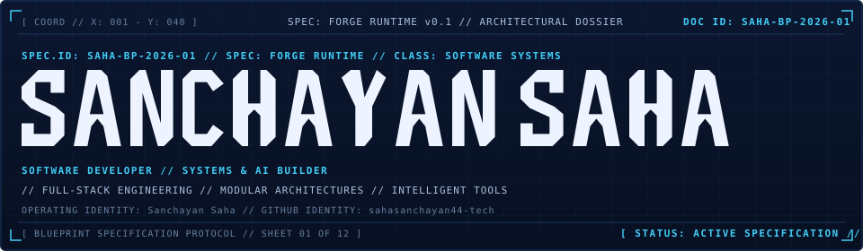
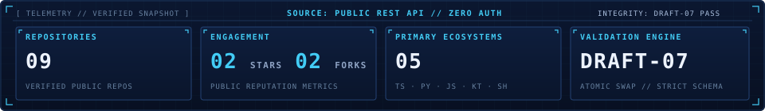

# SANCHAYAN SAHA // BLUEPRINT ARCHITECTURAL DOSSIER



```
[ COORD // X: 001 - Y: 040 ] [ SPEC: FORGE RUNTIME v0.1 ] [ DOC ID: SAHA-BP-2026-01 ]
[ OPERATING IDENTITY: Sanchayan Saha ] [ GITHUB: sahasanchayan44-tech // ID: 268472249 ]
[ CLASSIFICATION: SOFTWARE SYSTEMS // FULL-STACK // DISTRIBUTED ARCHITECTURES ]
```

---

## 01 // SYSTEM OVERVIEW

Building software systems at the intersection of **full-stack engineering**, **modular architectures**, and **intelligent applications**. Focused on structural clarity, component-level decomposition, and empirical verification across web platforms, spatial interfaces, and automated scripting.

### Architectural Philosophy & Engineering Approach

```
┌────────────────────────────────────────────────────────────────────────┐
│                        BLUEPRINT SYSTEM TOPOLOGY                       │
├─────────────────────┬───────────────────────────┬──────────────────────┤
│ 01 · STRUCTURE      │ 02 · VERIFICATION         │ 03 · EXECUTION       │
│ Modular contracts   │ Draft-07 schema checks    │ Deterministic runs   │
│ Strict boundaries   │ Automated test harnesses  │ Clean abstractions   │
│ Zero-leak isolation │ Snapshot schema audits    │ Resilient pipelines  │
└─────────────────────┴───────────────────────────┴──────────────────────┘
```

- **Structured Full-Stack Engineering**: Modular TypeScript, Next.js client-server interfaces, Python analytical services, container configurations (Docker), and local schema-validated data pipelines.
- **Applied Machine Learning & Statistical Modeling**: Algorithmic classification, synthetic curve modeling, and local inference orchestration tooling.
- **Spatial & Visual Systems**: WebGL, Three.js, and GLSL shader experiments exploring mathematical simulations and interactive graph structures.
- **Strict Separation of Concerns**: Explicit distinction between documented systems, working prototypes, companion tools, and exploratory concept prototypes.

---

## 02 // DEVELOPMENT STACK & CAPABILITIES

Technology taxonomy audited against the verified BLUEPRINT system specification:

### Core Languages & Runtimes
| Technology | Classification | Audited Ecosystem Scope |
| :--- | :--- | :--- |
| **TypeScript** | Primary | Strict typing, application logic, UI components, state management |
| **Python** | Primary | Statistical modeling scripts, analytical pipelines, automation |
| **JavaScript (ESNext)** | Supporting | Web standards, Three.js 3D visualizers, Node.js tooling |
| **Kotlin** | Mobile / Edge | Android companion client, offline database persistence |
| **Bash / Shell** | Infrastructure | Environment bootstrapping, pipeline automation, POSIX scripting |

### Frameworks & Ecosystems
| Category | Stack Components | Architectural Purpose |
| :--- | :--- | :--- |
| **Web & Services** | Next.js, React, Node.js, Express | Component-driven interfaces, REST endpoints, UI state |
| **Styling & Design** | Tailwind CSS, Native CSS Custom Properties | Blueprint CAD design systems, responsive typography, layout grids |
| **Spatial & Simulation** | Three.js, WebGL, GLSL Shaders | 3D neural visualizers, illustrative orbital trajectory simulations |
| **Data & Schema** | JSON Schema (Draft-07), REST APIs | Strict schema validation, atomic file pipelines, snapshot ingestion |
| **DevOps & Containers** | Docker, Git, Linux / POSIX | Containerized environments, modular deployment, developer scripting |

---

## 03 // PROJECT REGISTRY



Public engineering repositories audited from the verified GitHub snapshot:

| Repository | Primary Ecosystem | Architectural Classification | License Status | Scope & Technical Profile |
| :--- | :--- | :--- | :--- | :--- |
| [`portfolio`](https://github.com/sahasanchayan44-tech/portfolio) | `JavaScript` | Documented System | Unverified / Unspecified | Swiss-minimalist portfolio and 2D/3D Cultural Archive. Integrates Three.js 3D world with 8 interactive zones and structured static JSON CMS. |
| [`exam-oracle-ai`](https://github.com/sahasanchayan44-tech/exam-oracle-ai) | `Python` | Working Prototype | Unverified / Unspecified | Statistical examination analysis and practice generation platform. Structured as a Turbo monorepo coordinating Python analytical scripts and containerized microservice tooling. |
| [`synapse`](https://github.com/sahasanchayan44-tech/synapse) | `TypeScript` | Working Prototype | Unverified / Unspecified | Local developer AI assistant and code intelligence workspace. Integrates local LLM inference engines (Ollama) with FastAPI orchestration and React interface. |
| [`admin-panel`](https://github.com/sahasanchayan44-tech/admin-panel) | `TypeScript` | Working Prototype | Unverified / Unspecified | Administrative dashboard prototype featuring role-based access controls, paginated data tables, and interactive telemetry charts. |
| [`sunapse-android`](https://github.com/sahasanchayan44-tech/sunapse-android) | `Kotlin` | Tool / Companion | Unverified / Unspecified | Mobile companion client for the Synapse workspace. Built with native Android Jetpack Compose, Material Design 3, and offline Room database. |
| [`neuroverse`](https://github.com/sahasanchayan44-tech/neuroverse) | `TypeScript` | Concept Exploration | Unverified / Unspecified | Cognitive neural visualizer interface integrating interactive Three.js 3D brain models, an Express proxy, and Google Gemini multimodal API lookups. |
| [`chandrayaan-4.0`](https://github.com/sahasanchayan44-tech/chandrayaan-4.0) | `JavaScript` | Concept Exploration | Unverified / Unspecified | Experimental lunar exploration simulation dashboard. Explores mission trajectory visualization using Next.js 16 and Firebase listeners (UI simulation). |
| [`study-manager`](https://github.com/sahasanchayan44-tech/study-manager) | `TypeScript` | Tool / Prototype | Unverified / Unspecified | Academic sprint management application implementing deterministic task state machines, Nix bootstrapping, and local persistence. |
| [`aria`](https://github.com/sahasanchayan44-tech/aria) | `Shell` | Utility Script | Unverified / Unspecified | Linux shell automation scripts exploring zero-dependency toolchain configuration and local Ollama model runner bootstrapping. |

> **Audit Invariant**: All 9 repositories above are publicly accessible codebases verified via public REST API ingestion under strict Draft-07 schema compliance. Note: formal open-source license files are unverified/unspecified in the public API snapshot.

---

## 04 // RESEARCH LABORATORY (R&D INITIATIVES)

Specialized research modules documented in BLUEPRINT Sheet 07:

```
[ LAB-01 // SPACE TELEMETRY ] ────> Lunar Mission Tracking & Telemetry Simulation (chandrayaan-4.0)
[ LAB-02 // 3D COGNITIVE SYSTEMS ] ─> 3D Cortical Modeling & Multimodal AI (neuroverse)
[ LAB-03 // STATISTICAL ML ] ──────> Statistical Examination Analytics & Monorepo Services (exam-oracle-ai)
[ LAB-04 // LOCAL AI AUTOMATION ] ──> Local LLM Provisioning & Agent Runners (aria)
```

- **LAB-01 — Space Telemetry (`chandrayaan-4.0`)**: Experimental frontend interface evaluating client-side canvas trajectory visualization and simulated lunar descent steps using Next.js 16 and Firebase listeners. *(Status: Experimental Concept // Illustrative UI simulation).*
- **LAB-02 — 3D Cognitive Systems (`neuroverse`)**: Documented prototype synthesizing interactive Three.js 3D brain mesh visualizers with Google Gemini multimodal API endpoints via an Express proxy. *(Status: Documented Prototype // Spatial Computing).*
- **LAB-03 — Statistical ML (`exam-oracle-ai`)**: Documented monorepo exploring score distributions and item synthesis algorithms using Python analytical scripts, Turborepo, and containerized Docker services. *(Status: Documented Research Project // Evaluated against synthetic educational distributions).*
- **LAB-04 — Local AI Automation (`aria`)**: Shell automation prototype exploring zero-dependency provisioning of local inference environments using Ollama and POSIX shell scripts on Linux workstations. *(Status: Active Technical Interest // Shell Automation).*

---

## 05 // ENGINEERING ACTIVITY & SNAPSHOT TELEMETRY

Telemetry parameters verified from the local snapshot (`docs/data/github-data.json`):

```
┌──────────────────────────────────────┬──────────────────────────────────────┐
│ TELEMETRY PARAMETER                  │ VERIFIED SNAPSHOT VALUE              │
├──────────────────────────────────────┼──────────────────────────────────────┤
│ Monitored Public Repositories        │ 09 Public Codebases                  │
│ Aggregated Public Stars              │ 02 Stars                             │
│ Aggregated Public Forks              │ 02 Forks                             │
│ Snapshot Event Ingestions            │ 22 API Query Transactions            │
│ Recent Recorded Commits              │ 38 Commits                           │
│ Historical Milestone Markers         │ 11 Architectural Milestones          │
│ Ingestion Schema Specification       │ JSON Schema Draft-07 (Strict Mode)   │
│ Ingestion Integrity Mechanism        │ Atomic Write + Guaranteed Cleanup    │
└──────────────────────────────────────┴──────────────────────────────────────┘
```

> **Telemetry Invariant**: The GitHub REST API `/users/{username}/events/public` endpoint supplies a rolling snapshot (up to 90 days or 300 events). Event counts represent public activity captured within the verified snapshot window.

---

## 06 // LEARNING ROADMAP & SPECIALIZATION

Active technical development trajectories documented in BLUEPRINT Sheet 09:

### Phase 01: Distributed Systems Core
- **Consensus & State Replication**: In-depth study of Raft, Paxos, and gossip protocol implementations.
- **Event-Driven Architectures**: Message queues, event sourcing patterns, and idempotency guarantees in high-throughput environments.
- **Storage Engines**: LSM-trees, B-tree variants, and write-ahead log (WAL) durability mechanics.

### Phase 02: Edge AI & High-Throughput Inference
- **Local Model Optimization**: Quantization techniques (INT4/INT8), ONNX runtime deployment, and WebGPU tensor execution.
- **Agentic Orchestration Frameworks**: Reliable tool invocation, schema validation, and memory retrieval pipelines for autonomous agents.
- **Systems Profiling**: Memory-leak detection, CPU instruction profiling, and zero-allocation networking patterns.

---

## 07 // BLUEPRINT ARCHITECTURAL DOSSIER NAVIGATION

The complete 12-sheet engineering dossier is maintained in this repository under `docs/` and structured as an interactive technical blueprint:

| Sheet | Designation | Core Technical Scope |
| :---: | :--- | :--- |
| **01** | `SYSTEM COVER` | Executive technical summary, CAD schematic projection, Forge Runtime v0.1 spec. |
| **02** | `BIOGRAPHICAL DATA` | Identity parameters, formal education, core technical disciplines, and career timeline. |
| **03** | `DEVELOPMENT STACK` | Audited language matrices, frameworks, spatial 3D engines, and container tooling. |
| **04** | `PROJECT ARCHITECTURE`| Structural blueprints, component schematics, and interactive repository detail modals. |
| **05** | `LIVE GITHUB ACTIVITY` | Snapshot telemetry ingestion, commit distribution, and repository activity cards. |
| **06** | `CONTRIBUTION ANALYSIS`| Codebase language composition, commit frequency telemetry, and repository velocity metrics. |
| **07** | `RESEARCH LABORATORY` | Concept R&D initiatives (LAB-01 to LAB-04) covering spatial simulations, 3D visualizers, and ML scripts. |
| **08** | `SYSTEM ARCHITECTURE` | Multi-tier client/service data flow diagrams and runtime orchestration topology. |
| **09** | `LEARNING ROADMAP` | Strategic technical progression trajectories for distributed systems and edge inference. |
| **10** | `ENGINEERING LOGBOOK` | Chronological release milestones, snapshot telemetry logs, and category filtering. |
| **11** | `CONTACT & CONNECTIONS`| Terminal dispatch interface, public channels, and cryptographic verification status. |
| **12** | `DOCUMENT INDEX` | Master document index, audit records, design specifications, and schema metadata. |

> **Local Preview Access**: In local runtime development, the complete 12-sheet dossier can be inspected by serving the `docs/` directory (`python3 -m http.server 8088 --directory docs`) and opening `http://localhost:8088/index.html`.
>
> **Engineering Case Study**: Read the [Engineering Case Study](./CASE_STUDY.md) for architectural analysis, data integrity audits, and production release verification.

---

## 08 // REPOSITORY GOVERNANCE & COMMUNITY STANDARDS

In adherence with GitHub Community Standards, the following engineering policies and contribution specifications govern this repository:

| Document | Scope & Specification | Reference Link |
| :--- | :--- | :--- |
| **Code of Conduct** | Contributor Covenant v2.1 behavioral standards and reporting procedures. | [CODE_OF_CONDUCT.md](./CODE_OF_CONDUCT.md) |
| **Contributing Guidelines** | Development setup, local preview, test harnesses, and PR protocols. | [CONTRIBUTING.md](./CONTRIBUTING.md) |
| **Security Policy** | Supported release lines and responsible private vulnerability reporting. | [SECURITY.md](./SECURITY.md) |
| **Issue Templates** | Structured forms for bug reports and feature requests. | [.github/ISSUE_TEMPLATE/](./.github/ISSUE_TEMPLATE/) |
| **Pull Request Template** | Verification checklists, security assertions, and change summaries. | [.github/PULL_REQUEST_TEMPLATE.md](./.github/PULL_REQUEST_TEMPLATE.md) |
| **Accessibility Statement** | Keyboard navigation, focus management, semantic structure, and reporting. | [ACCESSIBILITY.md](./ACCESSIBILITY.md) |

> **License Status**: Open-source license selection is currently pending repository owner decision.

---

## 09 // TECHNICAL METADATA & SYSTEM FOOTER

```
[ SYSTEM SPECIFICATION ] // BLUEPRINT SPECIFICATION PROTOCOL v0.1.0
[ AUTHOR ]               // Sanchayan Saha [sahasanchayan44-tech]
[ DOCUMENT TYPE ]        // ARCHITECTURAL DOSSIER // EXECUTIVE SUMMARY
[ RENDERING ENGINE ]     // GITHUB FLAVORED MARKDOWN + EMBEDDED CAD VECTOR ASSETS
[ SCHEMA INTEGRITY ]     // DRAFT-07 COMPLIANT // ATOMIC SNAPSHOT VERIFIED
[ REVISION ]             // REV: 0.1.0 // 2026-11-08
```

---
*Blueprint Architectural Dossier // Document SAHA-BP-2026-01 // Local Engineering Reference*
